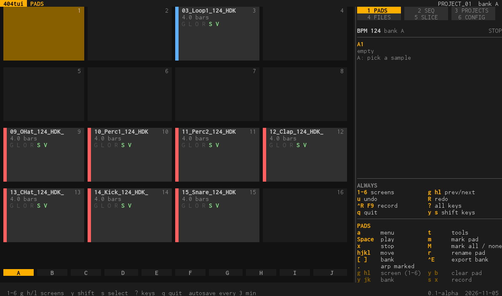
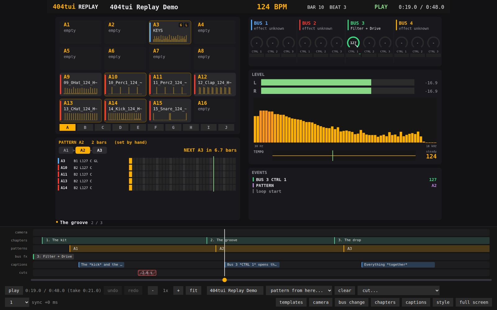
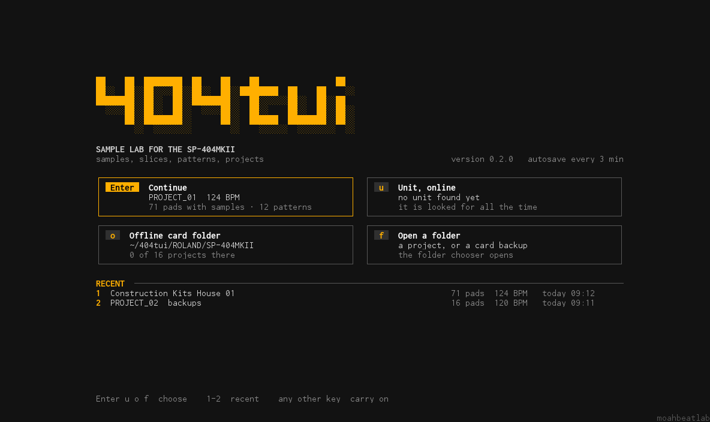
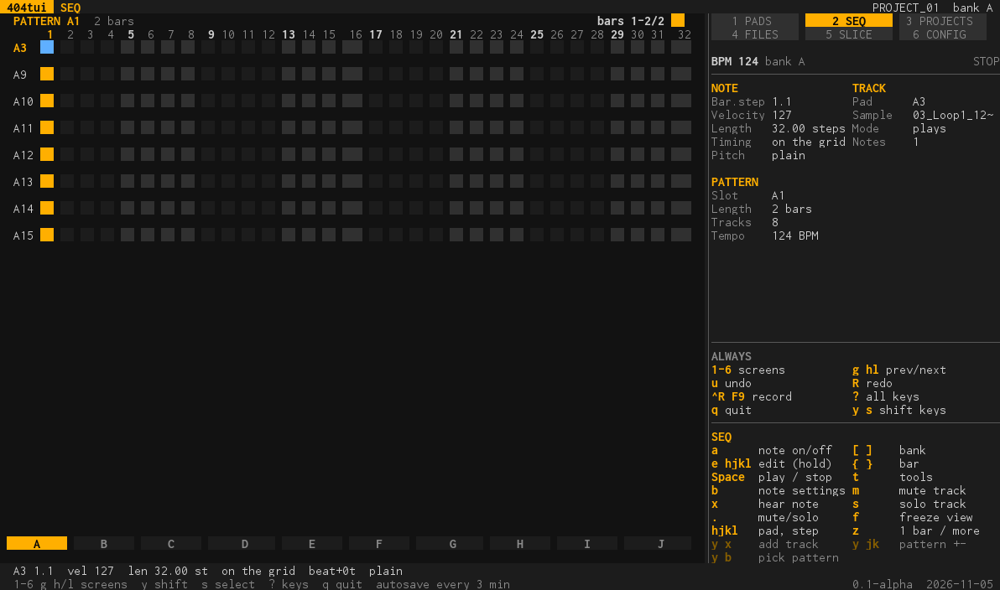
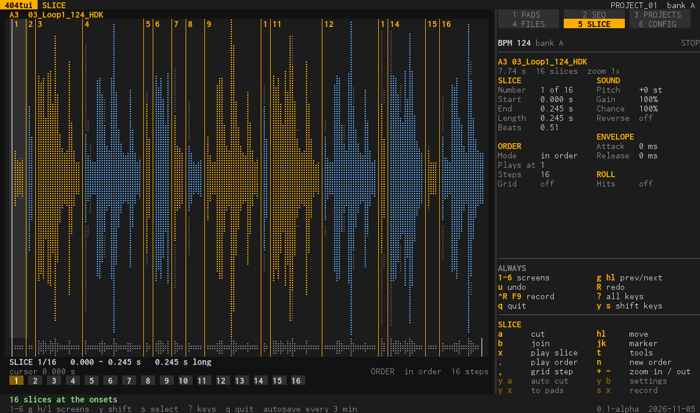
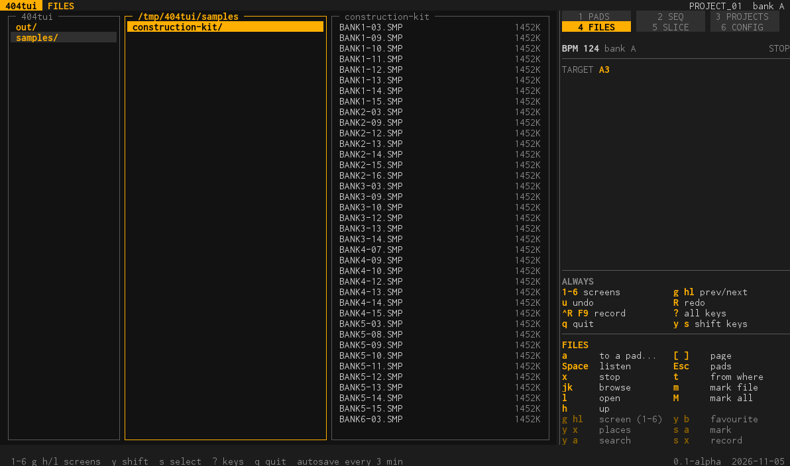
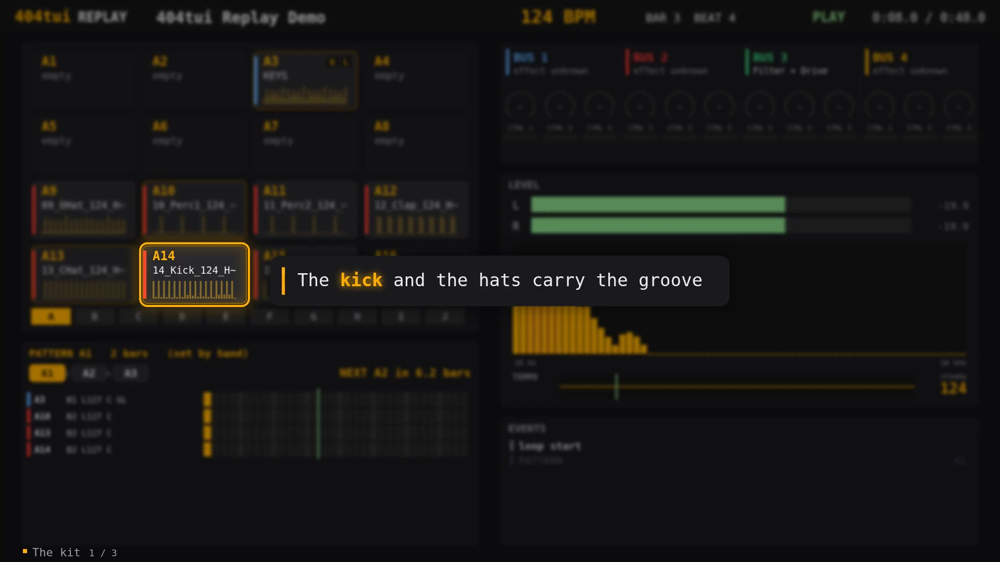
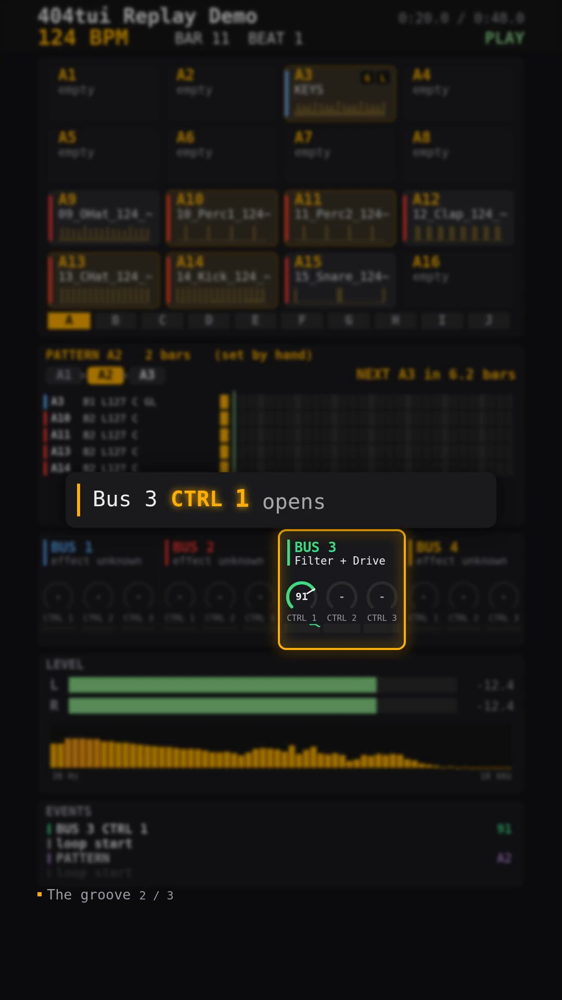
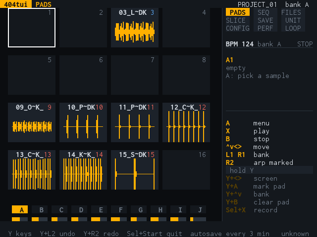

# 404tui

A sample, slice and pattern workshop for the Roland SP-404MKII: it runs in a terminal window on Linux, macOS and Windows (and on the R36S handheld), works on projects offline,
and talks to the unit over USB to load, send or live-edit its projects. It also records a performance together with what the unit did, and turns it into a video.

| The pads | The replay editor |
| --- | --- |
|  |  |

It is a Go port of [SparkyMK2](https://github.com/TuscanPL/SparkyMK2), whose authors reverse-engineered the protocol (comments here that mention `docs/re/` refer to that project's documentation).

## What it does

- **Pads and samples:** the 4x4 pads of a bank with their sample, sound, envelope, routing and playback; assign files to pads (a kit's numbered files go to the pad of that number), rename, copy, export, normalize; buses by pad name.
  → [the screens](docs/ui.md#the-screens)
- **Sequencer:** the pattern as the unit's step grid, two bars side by side; notes with velocity, length, timing and pitch; tools that write and change notes (fill, Euclid, echo, ratchets, accents, LFO, chance, cycle, nudge, pitch...), pattern
  templates from House to Footwork, swap a track with another pad, undo on everything. → [tools.md](docs/tools.md)
- **Slicer:** cut by hand, at the onsets, in equal parts, at random, on the grid; reorder, mangle, roll; slices to pads with a pattern under them.
- **Files and projects:** a ranger-style file browser with search, favourites, tags and an index of the unit's card; offline projects in a folder, the unit's 16 projects as tiles; back up, restore, send, edit live.
- **Record a set:** `Ctrl-R` records the unit's audio (24-bit, 48 kHz) with an event log of what the unit did (pads, knobs, clock, status).
- **Replay and video:** play a recording back as a picture of the unit, caption it, add chapters, cuts and a camera, and render an MP4 for YouTube, Instagram and TikTok (wide or vertical). → [replay.md](docs/replay.md)
- **Perform (experimental):** a stage dashboard, pad codes, the Faderfox EC4 map, and a phone page that also runs without any program, over Web MIDI, at <https://moahbeatlab.github.io/404tui/> ([docs/web.md](docs/web.md)). → [`docs/`](docs/README.md)

## Status: v0.1

- **Checked against a real SP-404MKII:** reading the unit's project (pads and patterns), polling its status, MIDI input (pad notes, clock, start/stop), recording its USB audio, pressing a pad over USB, setting a pad's
  level (which is how the program mutes) and switching the pattern with a Program Change. What the unit does and does not tell the program: [docs/unit-messages.md](docs/unit-messages.md).
- **Tried against the simulator and real project files only:** sending, restoring and live-editing whole projects, and the files of the unit and its card. `sp404 doctor` compares the program with the unit read-only; run it first (see below).
- **The handheld version** is tried on an R36S in part: see [docs/handheld.md](docs/handheld.md).
- It is not signed, and not affiliated with Roland.

## Getting started

404tui is a program that runs in a terminal window, and it opens one by itself when you double-click it:

- **Windows:** unzip the release, double-click `sp404.exe`. A console window opens with 404tui in it. If Windows says "protected your PC" (the program is not signed yet), choose *More info*, then *Run anyway*.
  If the program stops with a message, the window waits for Enter so you can read it.
- **macOS:** unpack the release and double-click `404tui.command` (not `sp404`): Terminal opens and starts it. The first time, macOS may refuse because the file came from the internet: right-click it,
  choose *Open*, then *Open* again (or in a terminal: `xattr -dr com.apple.quarantine <the folder>`).
- **Linux:** run `./sp404` in a terminal.

Plug the SP-404MKII in with its USB cable; 404tui finds it by itself and waits if it is not there yet. `?` shows the keys, `q` quits. Without a unit: `sp404 -sim` tries it against a simulated one, and
`sp404 check` tests the installation. More in [docs/install.md](docs/install.md).

## A first look

`sp404` with no command opens the program: six screens, side by side, numbered 1 to 6 (PADS, SEQ, PROJECTS, FILES, SLICE, CONFIG). The panel on the right is always there: the tempo, what is under the cursor and the keys that
work now.

| SEQ | SLICE | FILES |
| --- | --- | --- |
|  |  |  |

    sp404                                  # starts in ~/404tui/samples, writes below ~/404tui/out
    sp404 -project "path/to/PROJECT_01"    # open a project folder (one with a PADCONF.BIN in it)
    sp404 -samples ~/Music/kits -out ~/Desktop/card
    sp404 -sim                             # PROJECTS finds a simulated unit

Keys are vim-style (`h j k l`, `g`/`G`), `y` is the shift, `?` lists every key. The whole program in detail: [docs/ui.md](docs/ui.md), with every screen, menu and setting in [docs/tools.md](docs/tools.md).

## Commands

| Command | What it does |
| --- | --- |
| `sp404` | the program (also `sp404 menu`) |
| `sp404 serve` | Perform on a phone or tablet, served on the network ([docs/web.md](docs/web.md)) |
| `sp404 replay take.wav` | the replay of a recording in the browser, with the editor ([docs/replay.md](docs/replay.md)) |
| `sp404 replay render take.wav -o take.mp4` | the video (`-format vertical` for shorts and reels) |
| `sp404 probe pad\|pc\|watch` | what the unit does when it is told something, and what it says when you do something ([docs/unit-messages.md](docs/unit-messages.md)) |
| `sp404 check` | checks this installation: the computer, the program on a simulated unit, a plugged-in unit |
| `sp404 doctor` | read-only checks of this program against the unit; run it first |
| `sp404 ports`, `status`, `pads`, `ls [path]` | look at the unit |
| `sp404 beep`, `play <file>` | test the computer's audio output |
| `sp404 midimap` | print the Faderfox EC4 map |

Flags: `-sim`, `-port`, `-audio`, `-samples`, `-out`, `-project`, `-offline <folder>`, `-v` (a debug log), `-trace` (every message on the wire), `-version`.

## Replay: from a recording to a video

`Ctrl-R` records a set; `sp404 replay` opens it in the browser as a picture of what the unit did, and is a small video editor: captions that look at a pad or a bus, chapters (with the list for a YouTube
description), cuts, a camera with scenes and layouts, a look with palettes and a background picture, templates for the next take. `sp404 replay render` makes the MP4.

| Wide | Vertical (safe for Instagram and YouTube) |
| --- | --- |
|  |  |

It needs ffmpeg and a Chrome, Chromium, Edge or Brave. [docs/replay.md](docs/replay.md) has all of it.

## The handheld

The same program runs on the R36S (ArkOS, 640x480) as `sp404h`, with the same screens and menus, played with its buttons. [docs/handheld.md](docs/handheld.md).

## Documentation

[`docs/README.md`](docs/README.md) lists the pages: the program ([ui.md](docs/ui.md), [tools.md](docs/tools.md)), the replay ([replay.md](docs/replay.md)), the unit ([unit-messages.md](docs/unit-messages.md)),
the handheld, installing and building ([install.md](docs/install.md)), the earlier tabs, how it is put together ([architecture.md](docs/architecture.md)) and its tests ([e2e.md](docs/e2e.md)).

## Build

    make                    # ./sp404 for this computer
    make dist               # every platform, into dist/
    make dist VERSION=0.1   # stamp a version into the binaries
    make handheld-card      # the R36S's program and launcher, in dist/handheld

Linux and Windows build without cgo from any computer. The macOS binaries need cgo (the serial port library asks IOKit for the USB ports), so `make macos` runs on a Mac. MIDI input is in every release;
building yourself, `make build` includes it on a Mac, on Linux when the ALSA headers are installed (`libasound2-dev`) and on Windows always, otherwise `go build -tags midi` (needs cgo).
Tests: `go test -race ./...` or `make test`. More: [docs/install.md](docs/install.md).

## Before you run it on a unit

1. `sp404 ports` lists every serial port and why each is or is not taken for the unit (USB id `0582:02e7`).
2. `sp404 doctor` runs read-only checks and compares what this program parses with what the unit says. It changes nothing; add `-preview` as an argument to also play a pad.
3. `sp404 -v` writes a debug log (every transaction with its timing, port discovery, connects and the keys pressed); `-trace` adds every message as hex.

Back a project up before you send one (the unit's project menu, *Back up*). Details: [docs/install.md](docs/install.md).

## Licence

GPL-3.0-or-later, as SparkyMK2. See `LICENSE`. Not affiliated with or endorsed by Roland.
