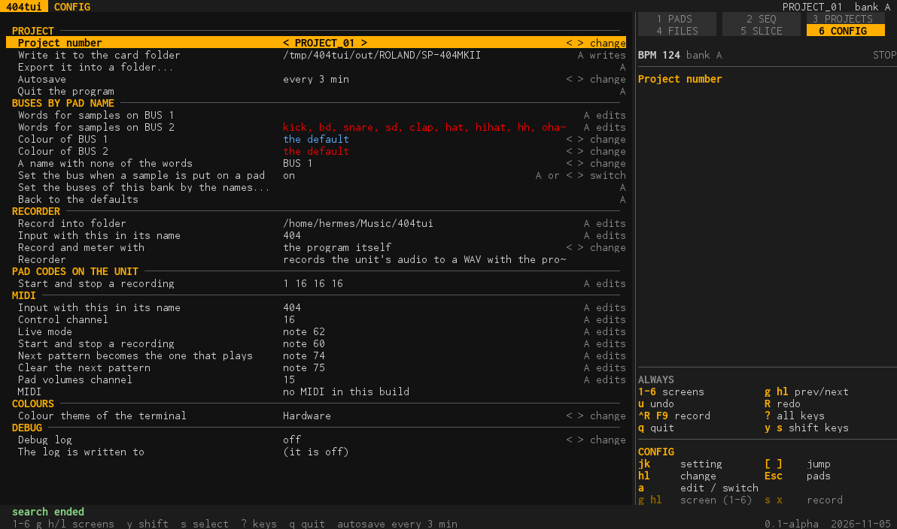

# CONFIG (screen 6)

The program's settings. On a computer the writing of the project (what SAVE does on the handheld) is the first section.

Move with `j k`, change a value with `h l`, and `a` edits (a one-line prompt: `Enter` done, `Esc` gives it up) or switches. `[ ]` jump between the sections.

## Sections

- **Project:** the project number, *Write it to the card folder*, *Export it into a folder...*, the **autosave** (every 3 minutes by default; autosaves and settings are kept beside the card folder), and *Quit the program*.
- **Buses by pad name:** a pad goes to a bus by its name. Two lines of words, one for the samples that go to BUS 1 and one for BUS 2 (the second starts with the words of a drum kit: kick, snare, hat, perc...), the colour each bus is drawn in, the bus of a name with none of the
  words (BUS 1 to start with), and whether the bus is set when a sample is put on a pad. A word matches a word of the pad's name (`Kick_125`, `OHat`, `14_Perc1`); a name with words of both lines goes to BUS 1. *Set the buses of this bank by the names...* applies the rule, and *Back to the defaults* resets it.
- **Recorder:** the folder `Ctrl-R` records into (`~/Music/404tui` by default), the part of the input's name (`404`), what records and meters (the program itself, ffmpeg or sox) and the keys that start and stop a recording. See [ui.md](ui.md#recording-a-set).
- **MIDI:** the part of the input's name (`404`), the **controller** (the part of the name of its own input, `ec4` by default, its channel, 16, and whether its pattern is sent to the unit; see [ec4.md](ec4.md)), the control channel, the live mode, and the notes that start and stop a recording, make the next pattern the one that plays or clear it, and the channel of the pad volumes.
- **Colours:** the colour theme of the terminal (Hardware, Ocean, Paper).
- **Debug:** a debug log (what the program does, with timings; see [install.md](install.md)) and where it is written.

## Keys

**On a computer:** `j k` setting · `h l` change · `a` edit / switch · `[ ]` jump · `Esc` pads · `1`-`6` a screen.

**On the handheld:** D-pad setting and change · `A` edit / switch · `L1 R1` jump · `B` pads.

Every setting with its values: [tools.md](tools.md#config).
