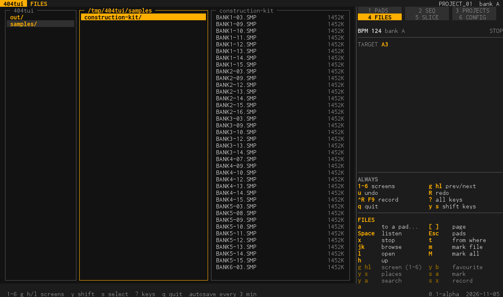
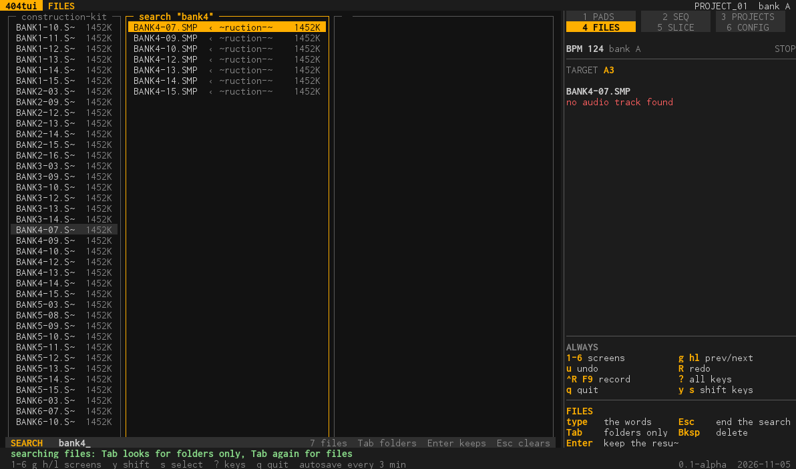

# FILES (screen 4)

The file browser: this computer, the samples folder, the unit's SD card and storage, a USB drive. It is where samples and projects come from.

## What is on the screen

On a wide window the **ranger view**: the folder above, this folder and a preview of what the cursor is on (the contents of a folder, a sample's shape and length, its tags). Audio files are listed with their size; a project (a folder with a `PADCONF.BIN`) is listed in green with the word *project*.
The panel names the target pad (`TARGET A3`, the pad the cursor was on in PADS) and the keys.

## What you do here

- **Browse.** `j k` up and down, `l` opens a folder, `h` goes up, `[ ]` page. `Space` listens to a sample on the computer's speakers, `x` stops. `Esc` goes back to PADS.
- **Put a file on a pad.** `a` opens the pad dialog and puts the sample on the pad you choose (the cursor follows to that pad). With files marked (`m` marks the file and moves on, `M` marks the whole folder), `a` puts them all on pads: files that start with a number (a kit: `03_Loop.wav`,
  `12_Clap.wav`) go on the pad of that number in the bank you choose, the others one after the other from the pad you choose, in the order of their names (`clap_2` before `clap_10`); files named EMPTY and silent ones are left out.
- **Search.** `y a` (or `/`) opens a one-line search: what you type filters the files of the folder and everything below it, and the line says how many are left. `Enter` keeps the result, `Esc` ends the search. `Tab` while typing changes what is searched: file names, then folders, then **categories**. `#` opens the search by categories at once: the categories are the words of a sample's name and of its folders, worked out as the unit's tag index does it (`kick`, `hat`, `loop`, `126`, `house`; `bd` is a `kick`, `hh` a `hat`), so `kick 909` finds every kick of a 909 kit however its file is named. You can add your own: in the files menu (`t`) **Tag as** puts the file (or, on a folder, everything in it) in a category with one key (`kick`, `snare`, `hat`, `bass`, `synth`, `loop`, `favourite`... left and right choose, `a` applies), and **Tag with words** takes any words (`909`, `c#m`, `wobbly`). They are kept in `tags.json` next to the settings, and the file's tags show in the panel. It needs an index of the folder (`t`, Index); the status line says which categories would narrow the result (`kick 340  hat 280 ...`).

- **Places and favourites.** `y x` lists the places (this computer, the samples folder, the unit's card and storage, drives, favourites); `y b` makes the folder or file a favourite. `t` chooses where files are loaded from and leads to the file tools.
- **File tools** (`t`, then *Copy, cut, rename, delete, tags...*): mark every file here, unmark, copy, cut and paste between the computer and the card, delete, rename, new folder.
- **Load a project.** A project in the list is loaded with `a` (see [projects.md](projects.md)).
- **Tags and the index of the unit's files.** With a unit plugged in, the files menu can **index** the folder you are in: every sample gets tags worked out from its name and the folders it is in (`SD:Synth/House/124_bass_wobble.wav` is synth, house, 124, bass, wobble).
  The index is one file on the card. **Search by tags** finds the samples that have them; **Tag** gives files tags of your own, **Favourite** the tag `favourite`. A platform without a unit does not offer this.

## Keys

**On a computer:** `a` to a pad... · `Space` listen · `x` stop · `j k` browse · `l` open · `h` up · `[ ]` page · `Esc` pads · `t` from where / file tools · `m` mark file · `M` mark all · `y x` places · `y a` or `/` search · `#` categories · `y b` favourite.

**On the handheld:** `A` to pad · `X` listen · D-pad browse, open and up · `L1 R1` page · `B` pads · `Y+X` places · `Y+A` search · `Y+B` favourite · `Sel+A` mark · `Sel+B` files menu.

Every menu with its entries: [tools.md](tools.md#files).
