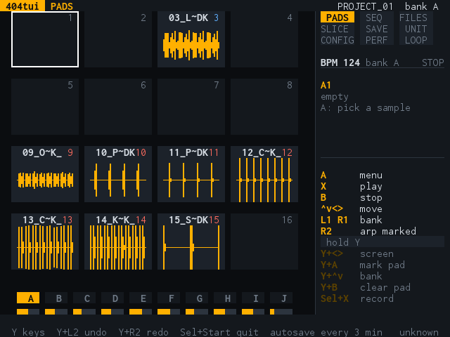
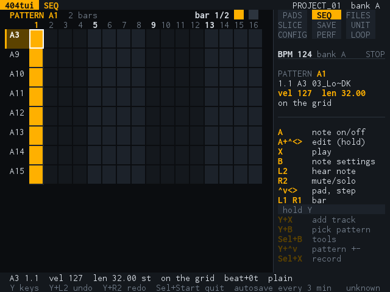

# The handheld version (R36S)

The same program runs on the **R36S**, a handheld game console with ArkOS (a 640x480 screen and a gamepad), so that samples, slices and patterns can be made away from the computer and loaded onto the SP-404MKII afterwards.
It is `sp404h`: the screens, menus and features of [the computer's program](ui.md), drawn pixel by pixel on the framebuffer and played with the buttons. Everything that is not the screen or the buttons is the same code
(`core`), so a project made on one opens on the other.

| PADS | SEQ |
| --- | --- |
|  |  |

The screen is 80 columns by 30 rows of cells, which is also the smallest window the computer's program accepts. The right 30% is the panel that is always there: the screen map, the tempo, what is under the
cursor and the keys that work now, **in the buttons' names**.

## The buttons

The pad has a D-pad, A, B, X, Y, L1, R1, L2, R2, Start and Select. **Y is the shift**: hold it for the second function of the next button (`Y+A` marks a pad, `Y+L2` undoes, `Y+R2` redoes). The panel on every screen lists
what the buttons do there. The computer's keyboard has the same eight keys under other names (`h j k l`, `a`, `b`, `x`, `y`; see [the keys](ui.md#the-keys)).

## Installing it

    make handheld-card          # builds dist/sp404tui-arm64 and lays out dist/handheld/roms

Copy the contents of `dist/handheld/roms` onto the games card's `/roms` folder and restart EmulationStation. 404tui is then in *Ports*. Samples go in `/roms/404/samples`; projects are written to
`/roms/404/card`, the folder to copy to the SP-404MKII's card (settings and autosaves are beside it, in `/roms/404`). The launcher (`packaging/arkos/404tui.sh`) writes `logs.log` and copies it to a USB
drive when there is one, which is how a problem is looked into (the version is in the first line and in the corner of the screen).

## Trying it without the device

`sp404h -script "..."` plays keys and saves a picture of the screen for each `@name`, which is how the pictures above were made:

    sp404h -silent -open "path/to/PROJECT_01" -samples ./samples -shots ./shots -script "@pads Y+R @seq"

And `packaging/arkos/emulator/` runs the launcher and the program in an arm64 container with the ArkOS userspace, the screen being a web page with the eight keys (see its README). It shows the launcher,
the start-up and the program; it cannot show the framebuffer, the gamepad's real codes or the sound.

## What has been tried on the device

- **Tried:** the launcher, the screen, the buttons (the shoulder buttons `L1`, `R1`, `L2`, `R2` have been checked, and undo and redo with them work).
- **Not yet tried on the device:** the sound output, sending to a real SP-404MKII over USB OTG, the quit chord, the speed with big projects, and the screens added after the pad panel.

The handheld has three screens more than the computer's six (SAVE, PERF and LOOP: on a computer the writing of the project is in CONFIG, and the looper and the MIDI monitor are not part of that program), and it has no recorder yet.
