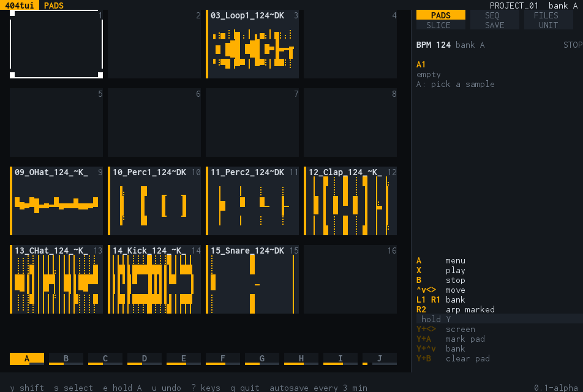
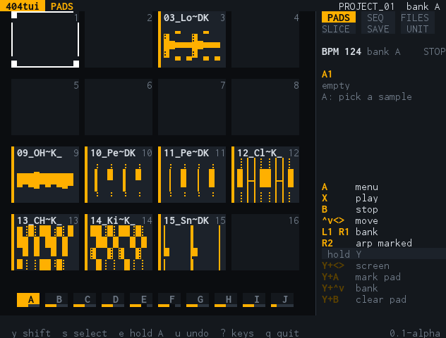
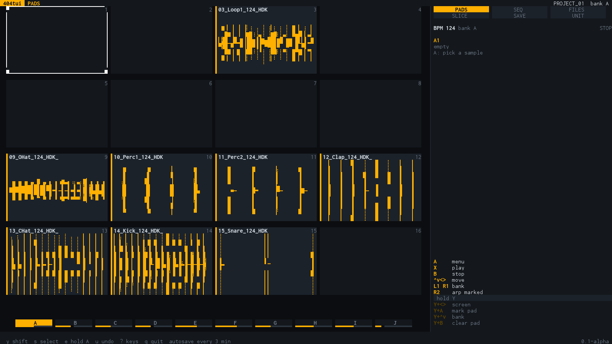
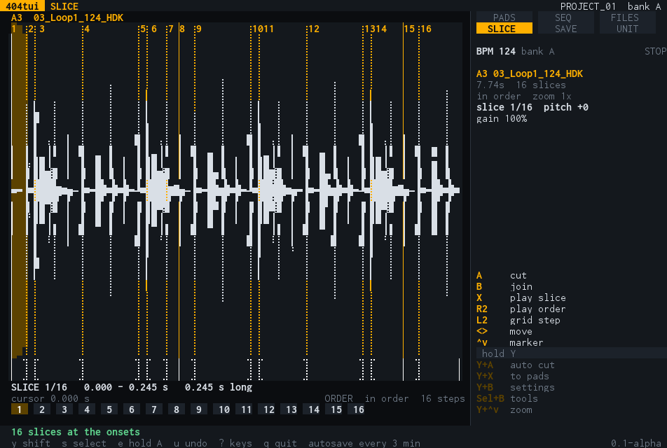
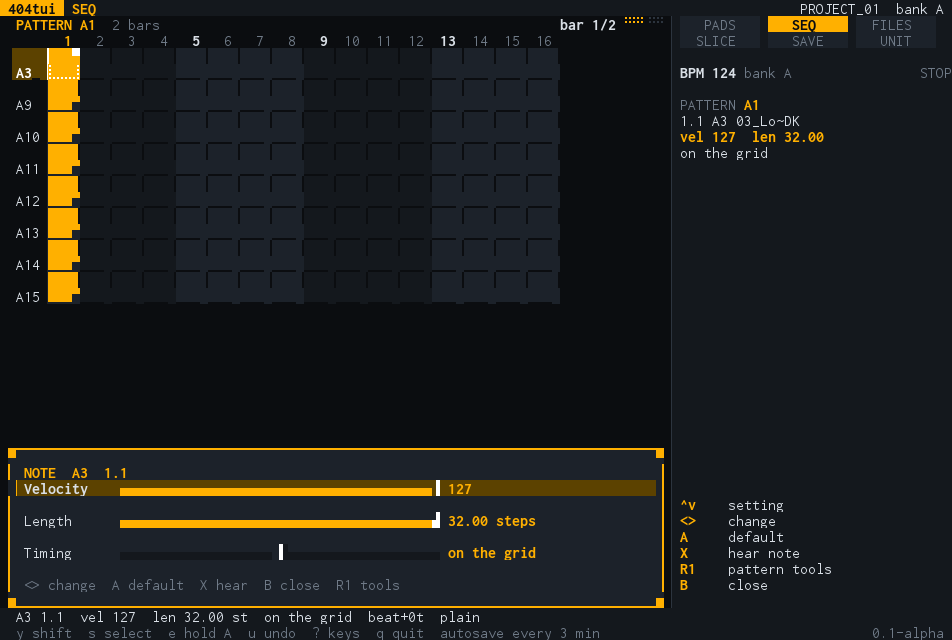

# Lab: samples, slicer, patterns and projects, offline

`sp404 lab` is the second way into 404tui. It needs no unit: it works on a project folder on this
computer (samples, pads, patterns, slices), plays on this computer's audio output, writes a project for the
SP-404MKII's SD card and sends one over USB when a unit is plugged in. It has the same screens, with the same
layout and the same keys, as the handheld version of 404tui (`handheld/`, for an R36S); the terminal tabs `1`–`8`
of `sp404` (Pads, Files, Slicer, Perform and the others) are the tool for working on the unit itself.

    sp404 lab                              # starts in ~/404tui/samples, writes below ~/404tui/out
    sp404 lab -project "path/to/PROJECT"   # open a project folder (one with a PADCONF.BIN in it)
    sp404 lab -samples ~/Music/kits -out ~/Desktop/card
    sp404 -sim lab                         # the UNIT screen finds a simulated unit

Flags of `lab`: `-samples` (the folder the file browser starts in), `-out` (where the card folder is made; settings
and autosaves are kept beside it), `-project`, `-basic-glyphs` (see below). The flags before `lab` are the usual ones:
`-sim`, `-port`, `-audio`, `-v`.

## One layout on every size

The screen is a grid of characters, and every screen is laid out on it, so it looks the same on a
laptop, a big monitor and the handheld's 80×30 screen:

- The window is measured when the program starts and again whenever it changes, and the screens are laid out for
  the new size at once.
- The right **30%** (at least 24 columns) is the panel that is always there: the six screens with the one you are
  on lit, the tempo and whether the loop plays, what is under the cursor, and the keys that work right now. The
  rest of the width is the screen itself: the pads and the banks, the step grid, the file list, the waveform.
- 80 columns by 30 rows is the smallest window (it is the handheld's screen: the picture is the same). In a smaller one
  the program says so and waits.

Waveforms, bars and faders are drawn with block characters (eighths of a cell), braille and half blocks, letters are
real letters. The program uses 24-bit colour when the terminal says it has it (`COLORTERM=truecolor`, Windows
Terminal, iTerm2, most current terminals) and the 256-colour palette otherwise. A terminal font with few glyphs
(the old Windows console) gets only full and half blocks: `-basic-glyphs`, or `SP404_GLYPHS=basic`.

## The keys

The screens are made for D-pad, A B X Y, L1 R1 L2 R2 and a second shift (Select). On a keyboard:

| Key | Button |
| --- | --- |
| `h j k l` or the arrows | D-pad left, down, up, right (as in vim) |
| `a` or `Enter` | A: do it, open, put a note, cut |
| `b`, `Esc` or `Backspace` | B: back, stop, join, the note settings in SEQ |
| `x` or `Space` | X: listen to what is under the cursor, play |
| `y` | Y is held for the **next** key: `y` then `l` is Y+Right (the next screen). `y` again lets go |
| `s` or `Tab` | Select is held for the next key: `s` then `b` opens the tools of the slicer or the sequencer |
| `e` | holds A, for editing a note with the arrows in SEQ (velocity, length, `[` `]` to move it); `e` again lets go |
| `[` `]`, `PgUp` `PgDn`, `Ctrl-U` `Ctrl-D` | L1, R1: pages, banks, tabs, bars |
| `,` `.` | L2, R2 |
| `u`, `Ctrl-R` | undo, redo (every change to the project, by snapshot) |
| `/` | search, in the file browser; the typed letters go into the search, `Enter` ends it |
| `?` | the help page for the keyboard |
| `q`, `Ctrl-C` | quit (twice when the project is not saved) |

The side panel always lists the keys that work now. In the lab it names the keys of the keyboard (`hjkl`, `[ ]`,
`y h` / `y l` for the next / previous screen, `s b` for Select+B), not the handheld's buttons; on the handheld it shows
the buttons. The shift that is waiting for its key is lit in the panel, and the block of keys that need it is headed
"y, then".

## The screens

The same six screens as on the handheld, described with all their keys in [`handheld/README.md`](../handheld/README.md):

- **PADS** — the 4×4 pads of the bank with their waveforms, the banks under them. `a` opens the pad panel: faders
  for the pad's settings (SOUND, SHAPE) and its tools: slice it, chords and arps, **arp from one sample** (a key,
  scale, chord stacks, octaves −3…+3, a keyboard, bounce a chord or an arp to a pad or print it to the pattern),
  reverse, normalize, pitch, move, copy, clear. `y` `a` marks pads (for bulk edits and the live arp).
- **SEQ** — the pattern as the unit's step grid, the tracks in use. `a` puts a note, `b` opens the **note panel**
  (faders for velocity, length and timing), `s` `b` the pattern tools (euclid, chance, randomize, echo, ratchet,
  LFO, envelope, fill, shape…), `y` `x` adds a track: the pad dialog, then a note on 1.1.
- **FILES** — the file system, with a preview. `/` searches, `y` `x` jumps to places and favourites.
- **SLICE** — cut by hand, at the onsets, in equal parts, at random, on the grid at the bank's BPM; the row under
  the waveform shows the order that will play and lights the step that sounds. `y` `b` is the settings of the slice
  and of the playing (order, grid, swing, humanize), `s` `b` the tools (cut, mangle, keep: result to a pad,
  slices to pads), `,` steps the grid.
- **SAVE** — writes the project as a folder for the card (`PROJECT_nn`), with an autosave every few minutes.
- **UNIT** — sends the project to a plugged-in SP-404MKII.

Every question "which pad?" is the same dialog: the banks across the top, 16 tiles with the names, `[` `]` for the
bank, `a` to choose, `b` to cancel.

## Tests

`termui/e2e/run.sh` builds the program for Linux, starts it in a terminal (tmux) in an Ubuntu container
against a copy of a real project, and plays the keys: the splash, the pads, the panel's width at five sizes, a window
that is too small, the vim keys, the pad panel, the arp, the slicer and its menus, the sequencer, the note panel, the
pad dialog, a typed search, saving (the files written are compared byte for byte with the project that was
opened) and quitting. Every step is kept as text and as a PNG of what the terminal showed (`termui/e2e/out/`).
`go test ./termui ./handheld` has the same keys and the layout at several sizes without a container.
