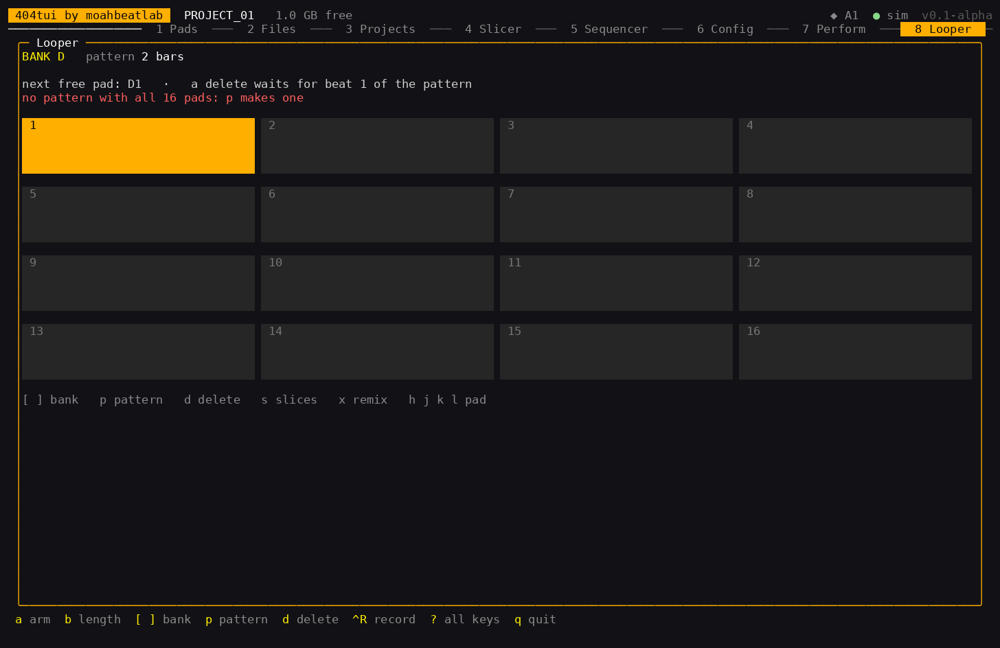

# Looper (tab 8)

The Looper is a bank of loops that play together. The loops come from wherever you like (the unit's own looper, copied to a pad;
the Slicer; a file), and this view keeps the bank and its pattern in order. It does not record sound itself.

Screenshot against the simulated device (`sp404 -sim`); the rail on the left is the bank, `[` `]`
change it.

- A **pattern** in which all 16 pads of the bank start on beat 1 and last the whole pattern (`p`, "MAKE PATTERN" on the page): a
  sample put on any pad plays from the next round on, and a pad that is deleted is silent, its note still in the pattern.
- **Bank** (`[` `]`). The length of the pattern is the unit's: it is read from the pattern of the bank in which all 16 pads play, or else from how long the loops on the pads are (2 bars when neither is known).
- **Delete** a pad's sample (`d`, twice). While the unit's clock runs, a delete waits for **beat 1** of the pattern counted from the unit's start; a second `d` before it happens takes it back. Without a running clock it is
  done at once.
- **Remix** (`x`): cuts the pad in front into equal slices (`s`: 4, 8, 16 or 32) in a random order and puts the result on the next
  free pad of the bank, muted. The web page has a fuller **Slicer** ([web.md](web.md)).

| Key | Does |
| --- | --- |
| `h j k l` | the pad in front |
| `[` `]` | the bank |
| `p` | make the pattern of the bank |
| `d` | delete the pad in front (twice) |
| `x` `s` | remix the pad in front, and how many slices |

## Work that waits for the pattern

A delete and a slice that is placed (from the web page's Slicer) do not act at once while the clock runs: the work on the unit (writing
the file, reading the pads) can make a gap, and beat 1 of the pattern, where everything is triggered again, is where it is least heard.
The pattern is as long as the length above. If you hear a gap at beat 1, tell me.

The samples are put on the unit without the Stop the official app sends before an import (the unit keeps playing); if the unit
refuses the import that way it is done the usual way.
