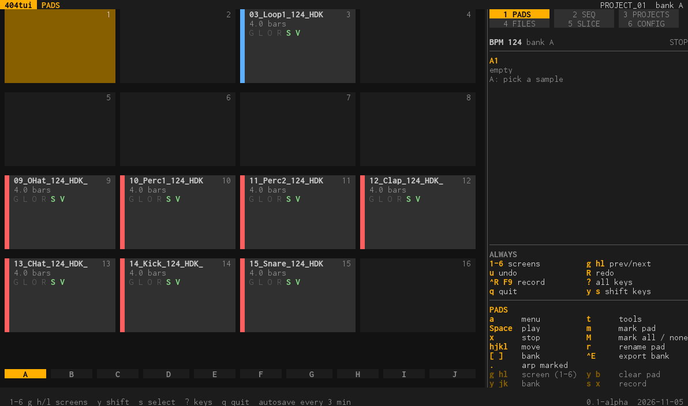
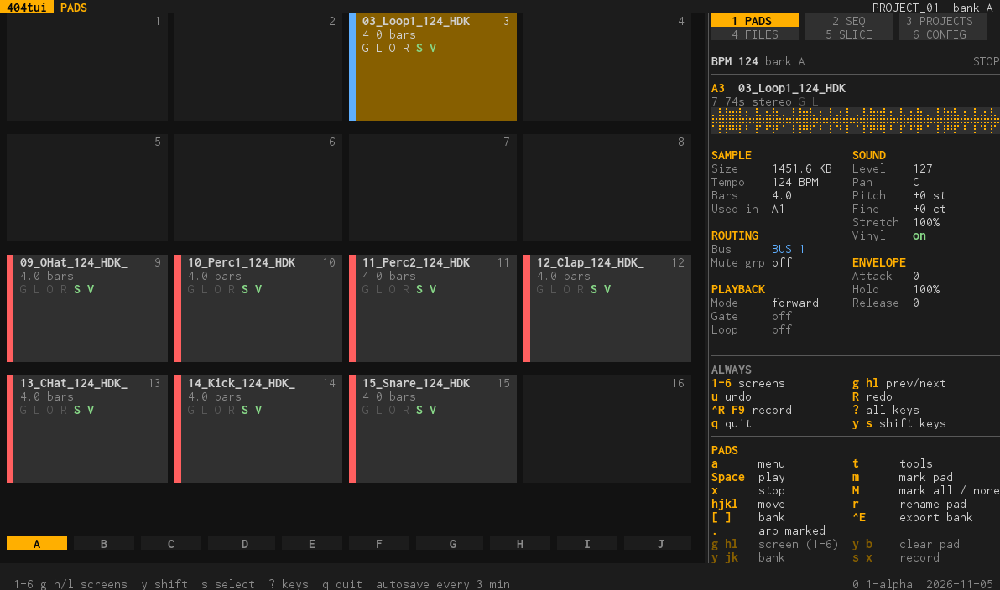
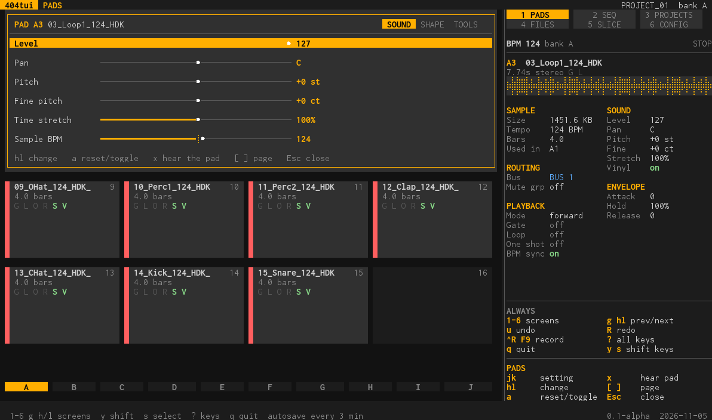
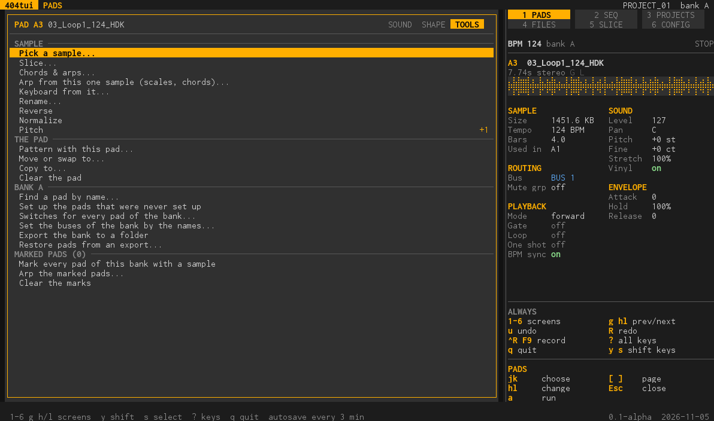

# PADS (screen 1)

The 16 pads of the bank in front, with the project's tempo. This is where you see what is on the pads and where you change how they sound.

## What is on the screen

- **The tiles** are the pads of the bank: the name of the sample, the length of its loop in bars, and the pad's switches in one row, **G L O R S V** (gate, loop, one shot, reverse or ping-pong, BPM sync, vinyl; a switch that is on is lit).
  The strip of a tile is the colour of the pad's bus (blue BUS 1, red BUS 2). Marked pads are marked on their tile.
- **The bank row** under the tiles, A to J, and the number of the bank in the corner of the panel.
- **The panel** on the right tells everything about the pad under the cursor: its sample (size, tempo, bars, where it is used), its sound (level, pan, pitch, fine pitch, stretch), its envelope, its routing (bus, mute group) and its playback (mode, gate, loop, one shot).

## What you do here

- **Move and play.** `h j k l` move over the tiles, `[` and `]` change the bank, `Space` plays the pad under the cursor and `x` stops what sounds.
- **Put a sample on a pad.** From FILES (4): `a` puts the file on a pad that you choose in the same dialog everything else uses to choose a pad. Marked files go on the pads of their numbers when they start with one (a kit's `03_Loop.wav` goes on pad 3 of the bank you choose).
  Or use *Pick a sample...* in the pad's tools. See [files.md](files.md).
- **Change how it sounds.** `a` opens the pad panel on the page SOUND (level, pan, pitch, fine pitch, time stretch, sample BPM); `[` and `]` turn to SHAPE (attack, hold, release, play mode, gate, loop, one shot, fixed velocity, vinyl, BPM sync, mute group, bus).
  A change is written into the project at once, `u` takes it back.

- **Change several pads at once.** `m` marks the pad and moves on, `M` marks all the pads of the bank (and again clears the marks); with pads marked, a change in the panel goes to all of them, and `.` plays an arp over the marked pads.
- **Use the tools.** `t` (or the page TOOLS of the panel) lists what can be done with the pad: slice it (opens SLICE), a **chord** (root and one of 29 chord types: major, minor, sevenths, ninths, elevenths, thirteenths...; and 24 common EDM **progressions** in the root's key, each with a name and its feeling, such as Epic anthem i VI III VII = Am F C G (euphoric, uplifting), as triads, sevenths, ninths or elevenths; `Enter` on the row opens a box of them all with the feeling of each, `Space` hears one, `a` takes it: hear them a chord a bar, or bounce every chord at once onto a run of empty pads), an **arp** (key, scale, the chord on a degree, rate, type, gate, length) (in both `Space` plays it once; with **Hold** on it repeats, the chord every bar and the arp as a loop, until `Space` again; **Sample is in** is the note the sample plays at, guessed from the pad's name such as `bass_G1` or `Pad Am`, else from its sound, else C, and changed by hand when the guess is wrong), a keyboard from it, rename, reverse, normalize, pitch, a pattern with this pad, move or swap, copy, clear,
  find a pad by name, set up the pads that were never set up, switches for every pad of the bank, set the buses of the bank by the names, export the bank to a folder (`Ctrl-E`), restore pads from an export, mark every pad with a sample.

- **Buses by name.** A pad goes to a bus by its name: CONFIG has the words for BUS 1 and BUS 2 (the second starts with the words of a drum kit: kick, snare, hat, perc...), and the tool *Set the buses of the bank by the names...* applies the rule to the bank. See [config.md](config.md).
- **Rename** a pad with `r`: a one-line prompt, `Enter` done, `Esc` gives it up.
- **Clear** a pad with `y` then `b`.

## Keys

**On a computer:** `a` pad panel · `Space` play · `x` stop · `h j k l` move · `[ ]` bank · `.` arp marked · `t` tools · `m` mark pad · `M` mark all / none · `r` rename · `Ctrl-E` export the bank · `y j k` bank · `y b` clear pad · `g h` and `g l` the screen before and after · `1`-`6` a screen · `u` undo, `R` redo · `?` every key.

**On the handheld:** `A` menu · `X` play · `B` stop · D-pad move · `L1 R1` bank · `R2` arp marked · `Y+<>` screen · `Y+A` mark pad · `Y+^v` bank · `Y+B` clear pad.

Every setting and every tool with the values it offers: [tools.md](tools.md#pads). The layout and the keys that work everywhere: [ui.md](ui.md).
