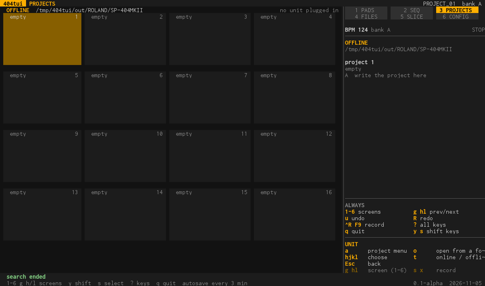
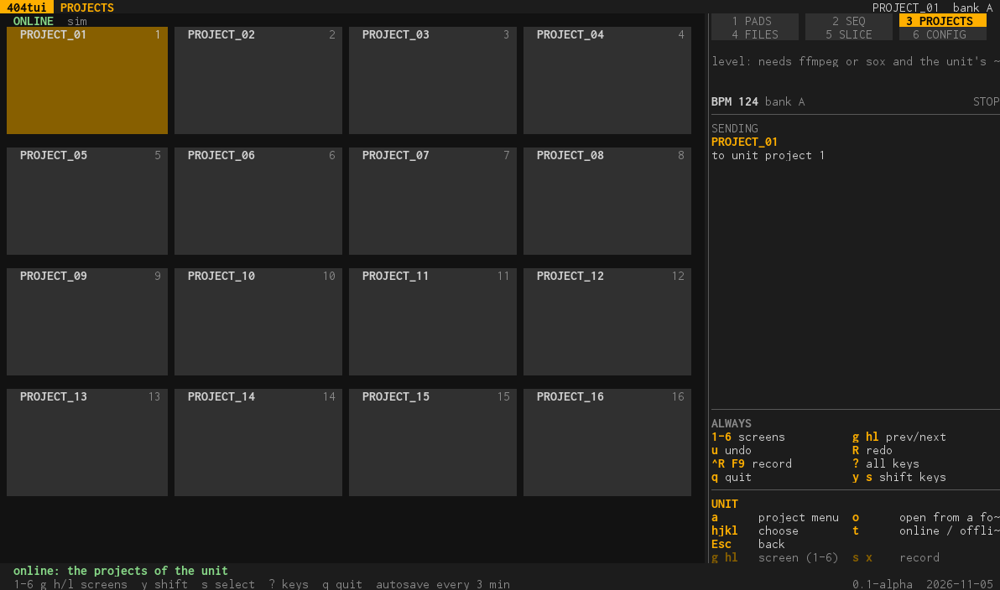
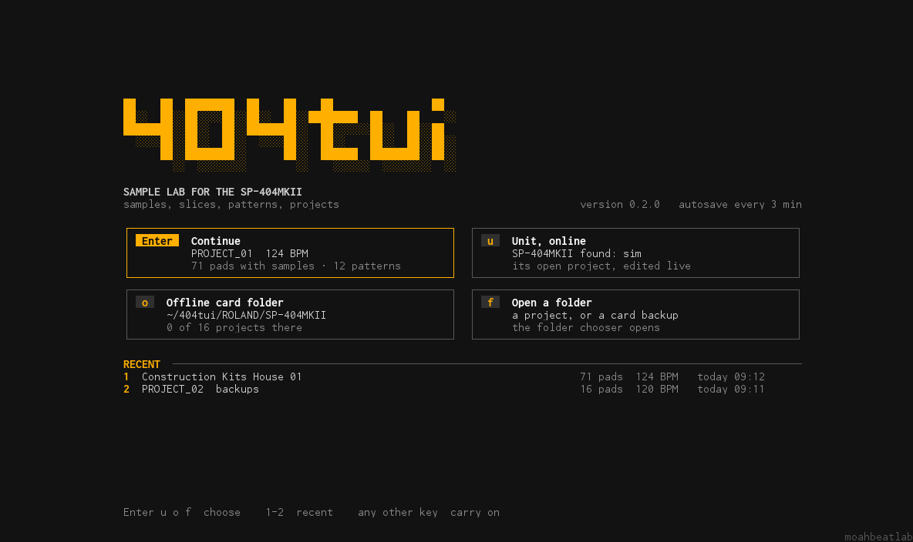
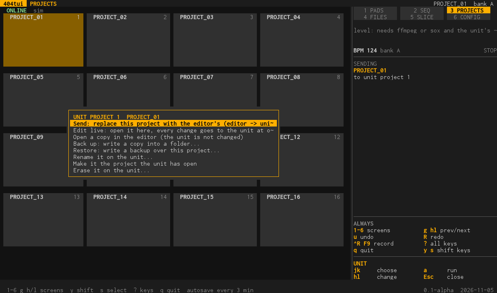

# PROJECTS (screen 3, UNIT on the handheld)

The 16 projects as tiles: the unit's, when one is plugged in (**online**), else those of a folder on this computer (**offline**). The program looks for the unit all the time (a USB cable, nothing to set up).

| Offline: the projects of a folder | Online: the unit's projects |
| --- | --- |
|  |  |

(The online picture is made against the simulator, `sp404 -sim`.)

## Online and offline

The **start screen** says whether it found a unit: `u` works online (this screen shows the unit's projects), `o` works offline and opens the project that was open last offline; any other key goes on with the project that is open. With no unit it says so and works offline.

On this screen `t` switches between the two and chooses the folder of the offline projects. While a unit is plugged in the panel has a **level meter** (left and right, with a CLIP light) and, in a window of 36 rows or more, a spectrum.

## What you do with the unit's projects (`a`)

- **Send:** replace this project with the editor's.
- **Edit live:** open it in the editor, and every change goes to the unit at once: names, settings, samples, clears, patterns, and undo too. What is changed on the unit itself comes into the editor within a few seconds. `LIVE n` in the title bar shows it, with how many changes are still on their way.
- **Open a copy in the editor** (the unit is not changed), **Back up** (a copy to this computer), **Restore** (write a backup over this project), **Rename**, **Make it the project the unit has open**, **Erase**.

Backups and exports open a **folder chooser** (`l` opens a folder, `h` goes up, `Enter` uses the one in front, `x` makes a new folder, `/` types a path, `[ ]` jump between home, the samples, the card folder and the drives); the folder is remembered. Back a project up before you send one.

## What you do with the offline projects (`a`)

Open a project from a folder, write the project of the editor into the folder (a slot of the 16), or export it into any folder. `o` opens a project from any folder: the folder chooser marks project folders; a project folder is opened in the editor, and a folder that holds
`PROJECT_nn` folders becomes the offline folder. The project open last offline is remembered. A project is a folder with a `PADCONF.BIN` (and its patterns and samples); from the command line: `sp404 -project <folder>`.

## Keys

**On a computer:** `a` project menu · `h j k l` choose · `Esc` back · `o` open from a folder · `t` project menu · `1`-`6` a screen.

**On the handheld (UNIT):** `A` project menu · `X` look again · D-pad choose · `L1 R1` page · `B` back.

Every menu: [tools.md](tools.md#projects). What the unit tells the program and what it does not: [unit-messages.md](unit-messages.md).
