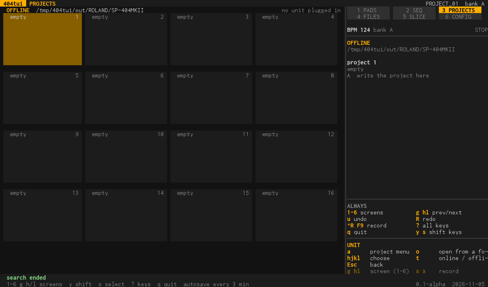
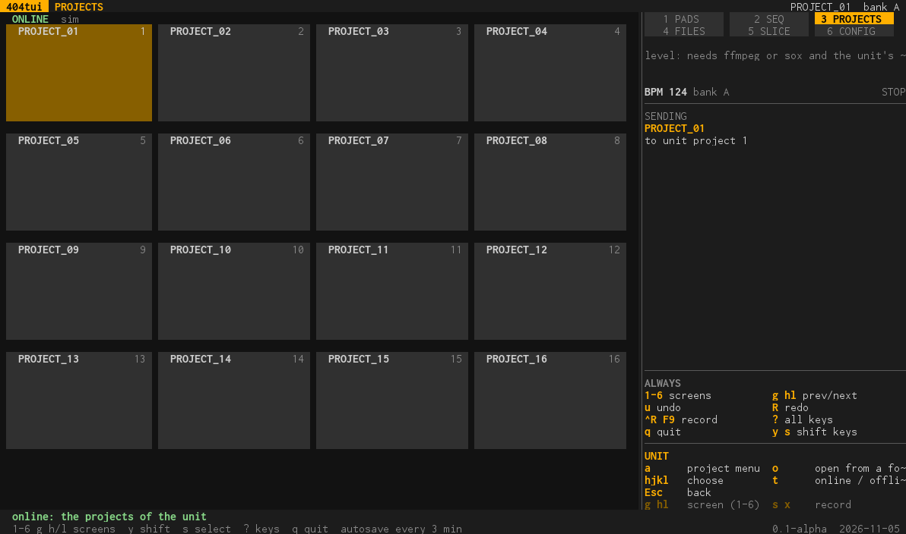
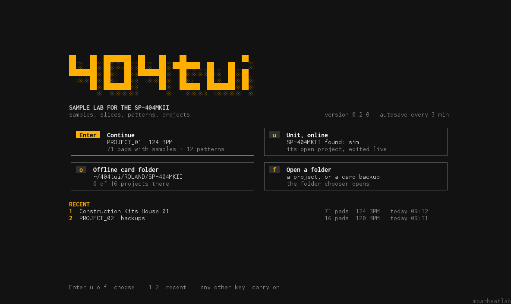
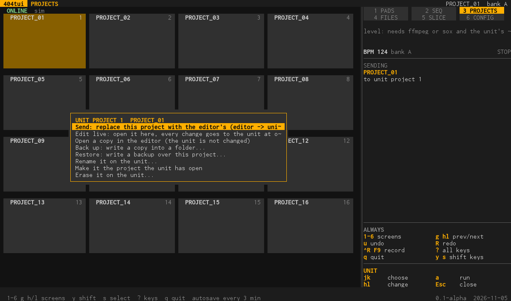

# PROJECTS (screen 3, UNIT on the handheld)

The 16 projects as tiles: the unit's, when one is plugged in (**online**), else those of a folder on this computer (**offline**). The program looks for the unit all the time (a USB cable, nothing to set up).

| Offline: the projects of a folder | Online: the unit's projects |
| --- | --- |
|  |  |

(The online picture is made against the simulator, `sp404 -sim`.)

## Online and offline

The **start screen** is a launcher: four doors with a key each, and the projects opened last.

| Key | Door | What it does |
| --- | --- | --- |
| `Enter` | Continue | goes on with the project that is open; with nothing open, opens the project opened last; with an autosave of an earlier session, restores it (then any other key starts empty) |
| `u` | Unit, online | the unit's open project is loaded and edited live (PROJECTS shows the unit's projects); with no unit it says so |
| `o` | Offline card folder | works offline and opens the project that was open last offline, else shows the folder's projects |
| `f` | Open a folder | the folder chooser: a project, or a folder of projects such as a card backup |
| `1`-`4` | Recent | the projects opened last (from a folder, from FILES, offline or with `-project`), with their pads, tempo and when |

Any other key goes on with what is open. The name at the top is drawn in pixel letters with a shadow.

On this screen `t` switches between the two and chooses the folder of the offline projects. While a unit is plugged in the panel has a **level meter** (left and right, with a CLIP light) and, in a window of 36 rows or more, a spectrum.

## What you do with the unit's projects (`a`)

- **Send:** replace this project with the editor's.
- **Edit live:** open it in the editor, and every change goes to the unit at once: names, settings, samples, clears, patterns, and undo too. What is changed on the unit itself comes into the editor within a few seconds. `LIVE n` in the title bar shows it, with how many changes are still on their way.
- **Open a copy in the editor** (the unit is not changed), **Back up** (a copy to this computer), **Restore** (write a backup over this project), **Rename**, **Make it the project the unit has open**, **Erase**.

Backups and exports open a **folder chooser** (`l` opens a folder, `h` goes up, `Enter` uses the one in front, `x` makes a new folder, `/` types a path, `[ ]` jump between home, the samples, the card folder and the drives); the folder is remembered. Back a project up before you send one.

## What you do with the offline projects (`a`)

Open a project from a folder, write the project of the editor into the folder (a slot of the 16), or export it into any folder. `o` opens a project from any folder: the folder chooser marks project folders; a project folder is opened in the editor, and a folder that holds
`PROJECT_nn` folders becomes the offline folder. The project open last offline is remembered.

**A new project on the SP card.** Put the card in the computer: PROJECTS finds it by itself (a drive with an `EXPORT/PROJECT` folder, at its top or a folder or two down) and says *an SP card is in: c uses it*; `c` (or *Use the SD card* in the menu) makes the card's `EXPORT/PROJECT` the offline folder, so the 16 tiles are the card's `PROJECT_01`..`PROJECT_16`. On an empty tile, *New project here...* asks for a name, writes an empty project there and opens it in the editor (work in the editor that is not saved is asked about first); put samples on its pads and *Write the project of the editor here* again. On the unit, `SHIFT + SUB PAD`, `SUB PAD`, OK and the pad of its number play it from the card (or IMPORT PROJECT copies it in). When the chosen folder is not there (the card is out), the top line says so in red.

**Names.** A project has a name inside it (up to 31 characters, what the unit shows on its project list); the tiles show it. *Rename project...* (on a project that is there) writes a new name into its `PADCONF.BIN` and changes nothing else; *Move it to another number (1..16)...* gives it another PROJECT_nn folder. *Name the project of the editor...* (on any tile, an empty one too) names the project in the editor: it is written with that name by *Write the project of the editor here*, an export or a send to the unit. Online, the unit's menu renames a project on the unit. A project is a folder with a `PADCONF.BIN` (and its patterns and samples); from the command line: `sp404 -project <folder>`.

## Keys

**On a computer:** `a` project menu · `h j k l` choose · `Esc` back · `o` open from a folder · `c` use the SP card that is in (offline) · `t` project menu · `1`-`6` a screen.

**On the handheld (UNIT):** `A` project menu · `X` look again · D-pad choose · `L1 R1` page · `B` back.

Every menu: [tools.md](tools.md#projects). What the unit tells the program and what it does not: [unit-messages.md](unit-messages.md).
