# Replay: from a recording to a video

`sp404 replay` turns a recorded performance into a video. It opens a page in the browser that plays the recording and draws what the unit did
(the pads, the pattern, the four buses with their knobs, the level and the spectrum), and it is also a small video editor: captions, chapters,
cuts, a camera, a look. What you set is kept in a file beside the recording, and `sp404 replay render` makes the MP4 from it, wide (1920x1080) or
vertical (1080x1920) for shorts and reels.

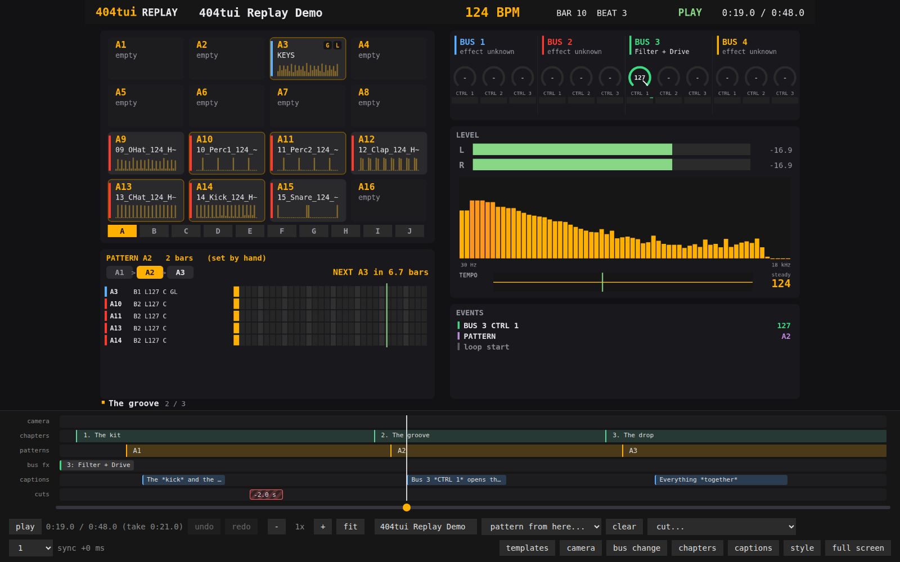

## What you need

- **A take:** a WAV and its event log, which the program writes while it records (`Ctrl-R`, see [Recording a set](ui.md#recording-a-set)).
  They sit side by side: `take.wav` and `take.events.jsonl`. The log holds the project too (pads, patterns), so the two files are enough.
- **To make a video:** `ffmpeg`, and Chrome, Chromium, Edge or Brave (the page is drawn in a headless browser, one picture at a time).
- **A camera video** is optional: a clip of you playing. The camera has no sound; you match it to the take by eye (see [The camera](#the-camera)).

## In three commands

    sp404 replay take.wav                          # the editor, in the browser
    sp404 replay take.wav -format vertical         # the same page in the 1080x1920 layout
    sp404 replay render take.wav -o take.mp4       # the video (add -format vertical for shorts and reels)

The event log is the file beside the WAV; give another one as a second argument. `Ctrl-C` ends the program; everything you set is kept
already.

## The editor

The picture is what the video shows. Under it:

- **The timeline** has a lane for each kind of thing: *camera* (scenes), *chapters*, *patterns*, *bus fx* (what a bus is used for, from a time on),
  *captions* and *cuts*. A white playhead runs through them. A block is dragged by its left edge (a caption by its body, and its edges change its length), clicked to
  edit, and a time near a loop start snaps to it. The slider below is the whole take; `-`, `+`, `fit` or `Ctrl` + the wheel zoom the lanes, which
  then scroll.
- **The bar** has play, the time (the time of the video, with the time of the take in brackets when something is cut), undo and redo, the zoom, the title of the
  video, *pattern from here...*, *cut...*, the speed and the sync of the events against the sound.
- **The sidebar** (the buttons at the right of the bar): *templates*, *camera*, *bus change*, *chapters*, *captions*, *style*. One is open at a time.

Every change can be undone (`Ctrl-Z`) and redone (`Ctrl-Shift-Z`): patterns, captions, chapters, cuts, bus changes, the camera and the title.

Keys: `Space` plays and stops; `←` `→` move 5 seconds (with `Shift` 30); `+` `-` zoom the timeline; `i` and `o` start and end a cut; `[` and `]` move the events
against the sound by 10 ms; `f` is full screen.

## Which pattern plays

The unit does not say which pattern plays (it sends no message when you change it; see [unit-messages.md](unit-messages.md)). So the log
usually has none, and the pattern panel says "not known". Tell the page where a pattern starts: choose it in *pattern from here...* at the playhead (the time snaps
to the loop start the unit sends). A pattern is a block on the *patterns* lane; drag its left edge to move it, click it to change or remove it, *clear* removes all.

Everything that follows from the pattern then follows the blocks: the pattern panel (its notes and the settings of its pads), the bank of the pads panel and the outline of
the pattern's pads, the flash of a pad when its note comes, the strip with the order of the patterns and the countdown ("NEXT A6 in 6 beats"), the
tempo of the bank and a muted pad. What was recorded (a pad hit, a mute, a knob) does not move when a block moves.

Without any pattern information the other panels work as they do: the pads, hits, counts and velocities, mutes, isolation, the knobs, the level and the spectrum, the list of
what happens, and the tempo from the clock. This needs the project in the log (a `project` line, which current versions write); for an older take without
it you can still set pattern names and the order and the tempo of the bank, but the notes and the names of the pads are not there.

## Captions

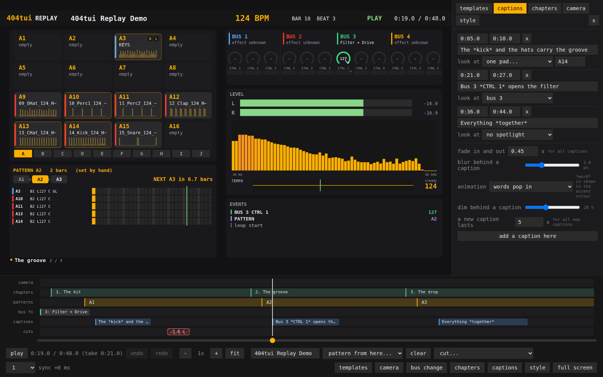

A caption is a line of text for a stretch of the take. Add one at the playhead ("add a caption here"), type the text and the times. **Look at** turns the picture to
what the caption talks about: the rest is blurred and dimmed, and the target stays sharp with a frame round it. The targets are the pads, one pad (`A14`), the
pattern, the buses, one bus (`bus 3`), the events, the level and the tempo.

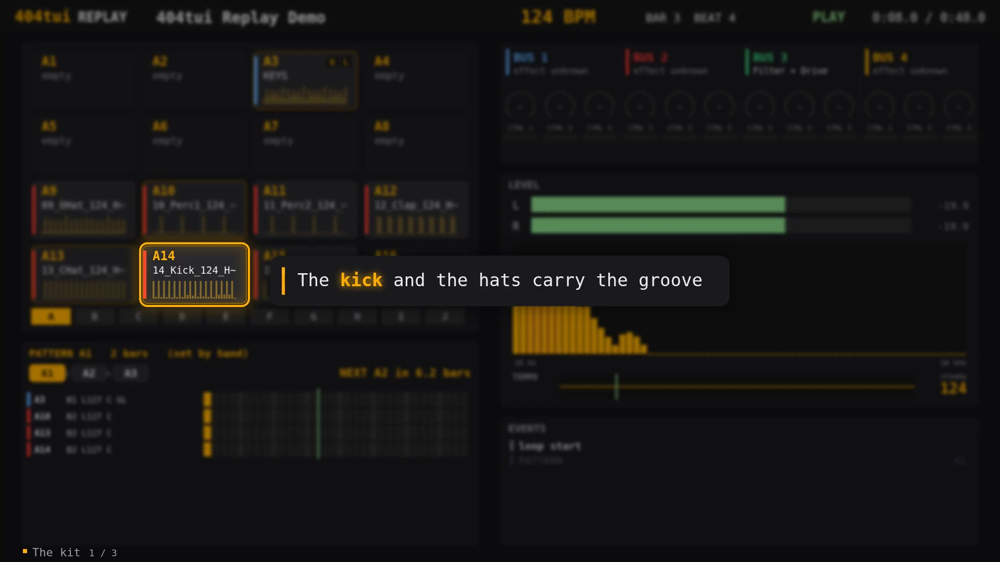

- **Animation** (for all captions): the card appears; the words pop in one after the other; or the text is typed letter by letter.
- **\*Stars\*:** a word between stars, like `*snare*`, is shown in the accent colour (it swells for a moment when it comes).
- **Settings for all captions:** the fade in and out, the blur and the dimming behind a caption, and how long a new caption lasts.

## Chapters

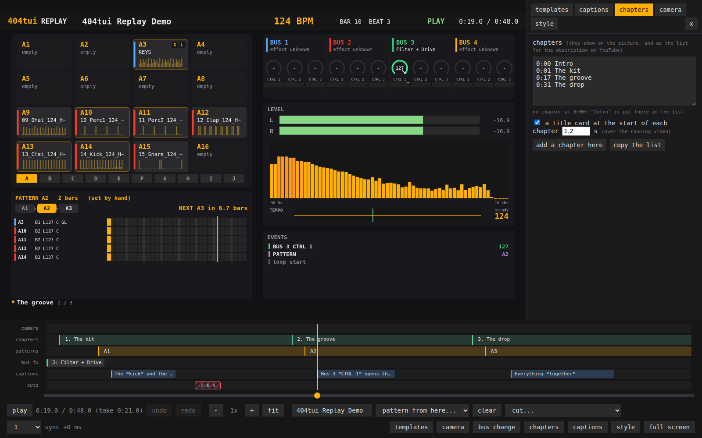

A chapter starts a part of the video: add one at the playhead and give it a title. Chapters are blocks on a lane, a small label on the picture, and the
**list for a YouTube description** (`0:00 Title`, a line each; also at `/chapters.txt` of the running page). YouTube wants a chapter at 0:00 (the list puts an
"Intro" there when there is none), at least three chapters and at least 10 seconds each; the tab says what is missing. The times in the list are the times of the video, with the cuts taken out.

**Chapter cards.** Tick "a title card at the start of each chapter" and each chapter opens with a card of about a second (set the length next to it) over the running video:

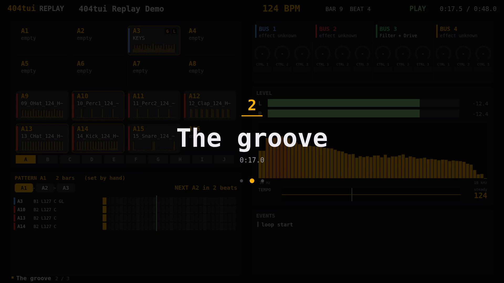

the number, the title, the time in the video and a dot for each chapter. A chapter inside a cut gets none. It is off by default.

## Cuts

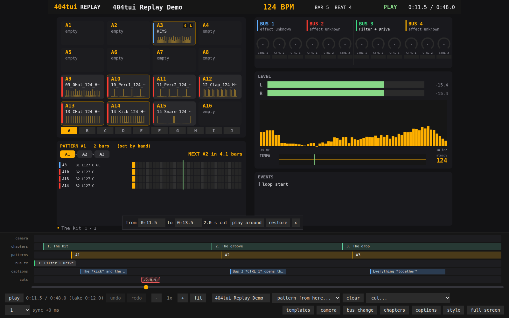

Parts of the take can be left out of the video. Drag over the *cuts* lane to cut that part, or use *cut...* in the bar: start a cut at the playhead (`i`), end it (`o`),
cut everything before or after the playhead, or restore all. A cut is a hatched block: click it to type its times, hear how the join sounds ("play around"), drag its
edges or restore it.

Playing skips the cuts and the clocks show the time of the video. Captions, chapters, patterns and camera scenes keep the time of the take (the lanes always show the whole
take); only the times shown for the video shift. The render leaves the cuts out of the pictures and of the sound, with a very short fade at every join so that it does not click.

## Bus changes

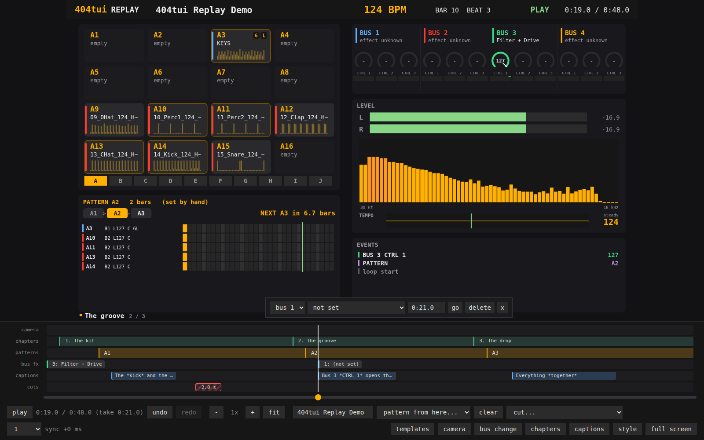

The unit does not tell which effect is on a bus. Say it once at the start (in *style*: BUS 1 to BUS 4) and, when it changes during the take, add a change at the
playhead: "from here on bus 3 is Filter + Drive". The bus headers on the picture show it, and the change is a block on the *bus fx* lane.

## The camera

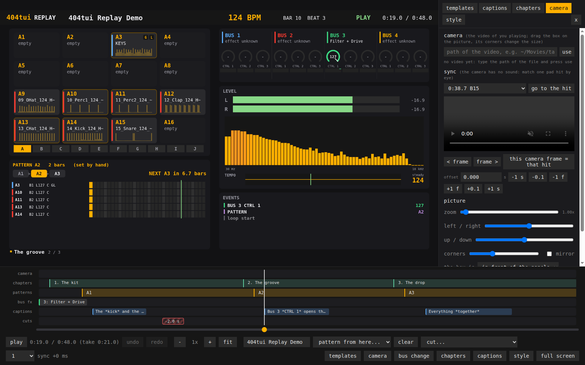

**Camera** takes a video of you playing: type its path and press *use*. The camera has no sound, so match it by eye: find a pad hit in the take, find its frame in the
video and set the sync. The box is dragged on the picture (its corners change the size; the zoom and the position of the cut-out are sliders), as a circle or a rectangle, mirrored or not, in front of the
panels or behind them.

A **scene** is a point on the timeline from which the box has a place and a size, for each format, and the panels that are shown. The box moves to the next scene's place in the time
you set, in the way the scene says: glide, cross-fade, pop in, slide in or cut, smooth, with a slow start and end, or springy. The panels a scene turns on or off fade.
A scene can take a **layout preset** that lays the panels out round the camera: *panels* (no camera), *left*, *right*, *corner*, *top*, *bottom* or *full* (the camera is the
picture). The render cuts the camera video into pictures with ffmpeg and puts them in the video (`-no-camera` leaves them out).

## The look

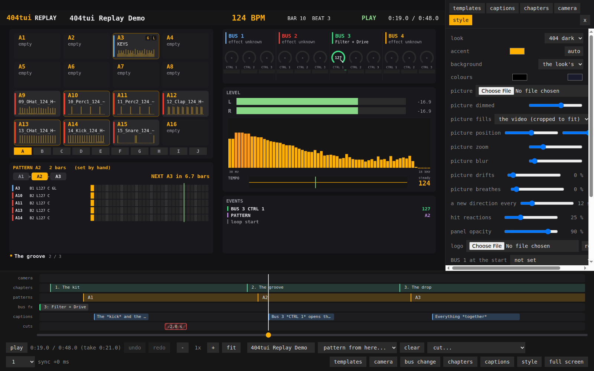

- **Look and accent:** a palette (404 dark, midnight, neon, forest, mono) and an accent colour (*auto* is the palette's).
- **Background:** the palette's, a colour, a gradient or a **picture**. The picture fills the video in the way you choose (cropped to fit, all of it, stretched, as tiles or
  centred), with a position, a zoom, a blur and a dimming. It can also **drift** slowly like a screensaver, in random directions that are the same every time for the same take, and
  **breathe** (zoom in and out a little); "a new direction every" is how many seconds each move takes.
- **Panel opacity:** how much of the background shows through the panels.
- **Hit reactions:** a pad that is hit pops up and glows (25 % by default; more adds a ring, over 50 % sparks; 0 is off).
- **Logo, handle and subtitle:** a picture and a line (`@name`) in the strip under the panels, and a subtitle in the vertical format.
- **BUS 1 to 4 at the start:** what each bus is used for.

A caption on the plain picture (nothing spotlighted) looks like this:

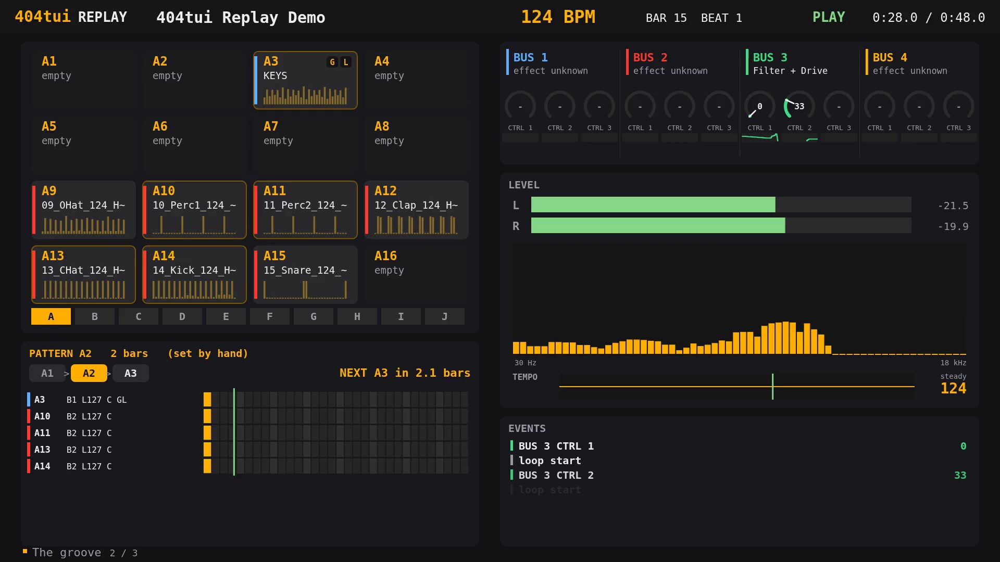

## Templates

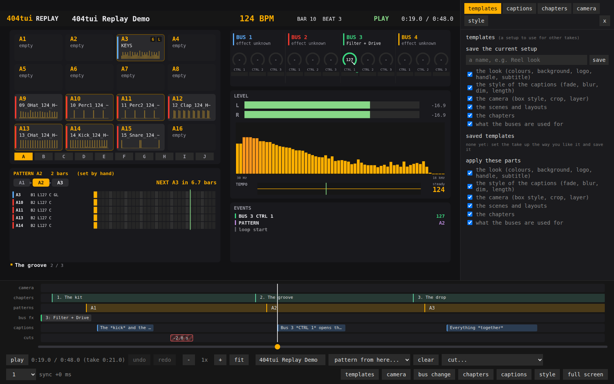

A **template** saves a setup under a name and lays it over another take, part by part: the look, the style of the captions, the camera, the scenes and layouts, the chapters, what
the buses are used for. The times of scenes and chapters are kept as a part of the length of the take, so they land in the right place on a take of another length. One template can be
the **default**: a take that has nothing saved yet starts with it. Applying one can be undone. The templates are files in the configuration folder (`404tui/replay-templates`, or
the folder in `$SP404_TEMPLATES`); copy a file to give a template to someone else.

## Wide and vertical

The same page draws both formats. `-format vertical` (or `?format=vertical` in the address) gives 1080x1920, with the panels one under the other.

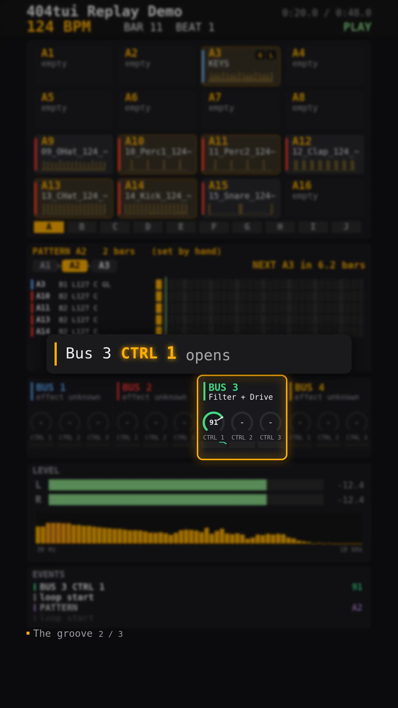

Phones that are taller than 9:16 (Instagram Reels, YouTube Shorts) show the video larger than the screen and cut about 48 px from each side, and the platforms put their buttons and the
title over the bottom. The vertical layout therefore keeps **72 px free at each side** and the bottom free. The header is at the top, where the phone's status bar covers a little of it.

## Making the video

    sp404 replay render take.wav -o take.mp4
    sp404 replay render take.wav -o reel.mp4 -format vertical -fps 30
    sp404 replay render take.wav -from 10 -to 40 -no-camera     # a quick draft of a part

| Option | What it does |
| --- | --- |
| `-o file.mp4` | the video (default: the WAV's name with `.mp4`, beside it) |
| `-format wide\|vertical` | 1920x1080 or 1080x1920 (default wide) |
| `-fps 30` | frames a second (30 or 60) |
| `-from`, `-to` | a part of the take, in seconds; the cuts inside it are left out as well |
| `-no-camera` | leave the camera video out: a much quicker draft |
| `-workers 4` | pages that draw side by side (default: half the processors, at most 4) |
| `-q "preset=neon&accent=%23ff3b30"` | more of the page's parameters (the saved look and title are used as they are) |
| `-chrome`, `-ffmpeg` | the browser and ffmpeg, when they are not found (also `$CHROME`) |
| `-no-sandbox` | for a browser that cannot start its sandbox (a container, a root account) |

The page is drawn in a headless browser one picture at a time, so it does not matter how fast the computer is, and the result is the same every time; ffmpeg puts the pictures and the sound together
(H.264 and AAC, `+faststart`). Several pages draw side by side. A take with a camera video is slower (the camera has to be cut into pictures as well): on a small computer a few frames a second.
The size of the output follows from the length of the take and the format; a draft of a short part with `-no-camera` shows the timing in a minute.

## What is kept, and where

Beside the recording, `take.events.cues.json` holds what you set: the title, the patterns, the captions, the chapters, the bus changes, the cuts, the path of the camera video with its sync and scenes, and
the look. It is plain JSON; copy it with the take to move the work to another computer. The page parameters for one viewing (nothing is kept): `format=vertical`, `title=...`, `preset=neon`, `accent=%23ff3b30`,
`handle=@name`, `subtitle=...`, `bgcolor=%23101020`, `hud=0` (no bar), `t=12` (start at 12 s), `pattern=A1` (one pattern throughout).

## Limits

- The camera is synchronised by hand.
- The panels do not flow by themselves: they are placed by the layouts (the presets).
- A render with a camera is slow; use `-no-camera` and `-from`/`-to` for drafts.
- Templates are files; there is no export or import in the page.
