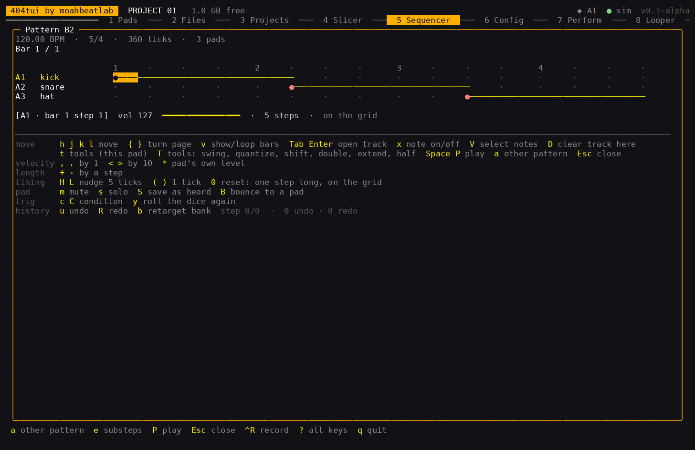

# Sequencer (tab 5) and patterns

A bank has 16 pattern slots. They are a panel under the pads (Pads tab, `Tab` moves between the two,
the highlighted pattern is previewed on the right) and are edited in the **Sequencer** tab: `5`, then
`a` chooses the pattern to edit and `N` makes a new one. `Esc` leaves the pattern.

A pattern open in the editor: a row per pad that plays in it (`kick`, `snare`, `hat` here), the notes
drawn on the step grid with the bar numbers over it, and under the grid the note in front — its
position, velocity and length. The screenshot is of the simulated device's pattern **B2**
(120.00 BPM, 5/4, 1 bar, 3 pads), which the unit already holds, opened with tab `5` then `a`.

## Opening, making and moving patterns

| Key | What |
| --- | --- |
| `a` | choose a pattern (in the editor: another one); arrows / `[ ]` bank, `Enter` open |
| `Enter` | open the pattern (from the panel) |
| `N` | **new pattern**: pick a template (see below) |
| `c` / `x` | pick a pattern up to copy / move, `p` puts it in a slot of any bank (twice replaces) |
| `v` / `d` | mark / delete |
| `b` | retarget the open pattern's pads to another bank |
| `P`, `Space` | play it **on this computer** in a loop, with a playhead (`s` stops) |

### New pattern (`N`)

A list in columns (name, length, tempo, voices) with the cursor spanning the row, and under it a
two-bar preview of the groove under the cursor. Templates: *All pads held* (every sample of the bank on
beat 1), *Blank*, and genre grooves (house, techno, DnB, jungle, dubstep, trance, UK garage, breakbeat,
trap, amapiano, reggaeton, disco, footwork and more). `j k`, `g G` move (the list scrolls on a small
screen), `Enter` / `Space` choose, `Esc` / `N` / `q` back. A groove asks how long (`h l` fewer / more
bars, `1`–`8` that many, `Enter` make it, `Esc` back).

## The step editor

Notes are blocks as tall as their velocity and as wide as they last. Pages of up to two bars: `{ }`
turn the page, `v` shows, edits and loops only some bars.

| Group | Keys |
| --- | --- |
| move | `h j k l` move · `Tab` / `Enter` open the track (a big 16-step lane; `Tab` folds it) · `x` (`Enter` in the lane) note on/off · `V` select notes · `D` clear the track here · `t` tools for this pad · `T` tools for the whole pattern · `Space` `P` play · `a` other pattern · `Esc` close |
| velocity | `, .` by 1 · `< >` by 10 · `*` the pad's own level (127) |
| length | `+ -` a step longer / shorter |
| timing | `H L` nudge 5 ticks · `( )` 1 tick · `0` back to one step long on the grid |
| pad | `m` mute · `s` solo · `S` save as heard · `B` bounce to a pad |
| trig | `c C` condition (forward / back) · `y` roll the dice again |
| history | `u` undo · `R` redo · `b` retarget bank |

### Modes

- **Expanded track** (`Tab` / `Enter`): `h l` step, `j k` other track, `Enter` / `x` note on/off, `Tab` folds.
- **Substep mode** (`e`, again to leave): the step at the cursor is divided like the unit's SUBSTEP.
  `h l` go through the parts, `x` / `Enter` switch a part on/off, `i` changes the split 2 → 3 → 4 → one
  note → 2. The detail line shows a box per part (filled plays, dotted silent). A split step keeps its
  mark with the number of parts after it.
- **Select notes** (`V`): `h j k l` move, `x` / `Enter` choose or let go, `a` every note of the track,
  `A` of every track. Then `, .` `< >` `*` velocity, `+ -` length, `H L ( ) 0` timing, `c C` condition,
  `d` take them out, `m s` mute / solo the track, `B` bounce. `Esc` / `V` leaves.
- **Tools** (`t` this pad, `T` the whole pattern): menu `j k` choose a tool, `h l` (or `- +`) change the
  amount, `e` eighth / sixteenth grid, `Enter` apply, `Esc` close. Tools: SWING, QUANT (quantize with a
  strength), SHIFT, REVERSE, HUMANIZE, DOUBLE (bars × 2, played again), EXTEND (bars × 2, new half
  empty), HALF (first half kept).
- **Conditions** (`c` / `C`): every loop, `1:2` … `8:8`, then chances (90, 75, 50, 25, 10 %). The unit's
  pattern files have no place for them, so they are kept on this computer (`conditions.json`), drawn
  `◐`, and apply to playback here and to a bounce. The pattern then runs as a cycle (the least common
  multiple of the conditions; with a chance at least 4 loops, rolled from a seed, `y` rolls again).

## Mute, solo, save and bounce

`m` mutes and `s` solos a pad (in Pads and in the editor); that only changes what this computer plays
(red `MUTE`, green `SOLO`, silent pads greyed). `S` saves the pattern **as you hear it** into a slot
you choose, without the muted pads (or with only the soloed ones), so the unit plays that version
too. `B` bounces the mix that plays here (as long as the pattern or the chosen bars) to one sample on a
pad you choose; solo a track to print only that one. The unit's envelope, effects and time stretch are
not in it.
