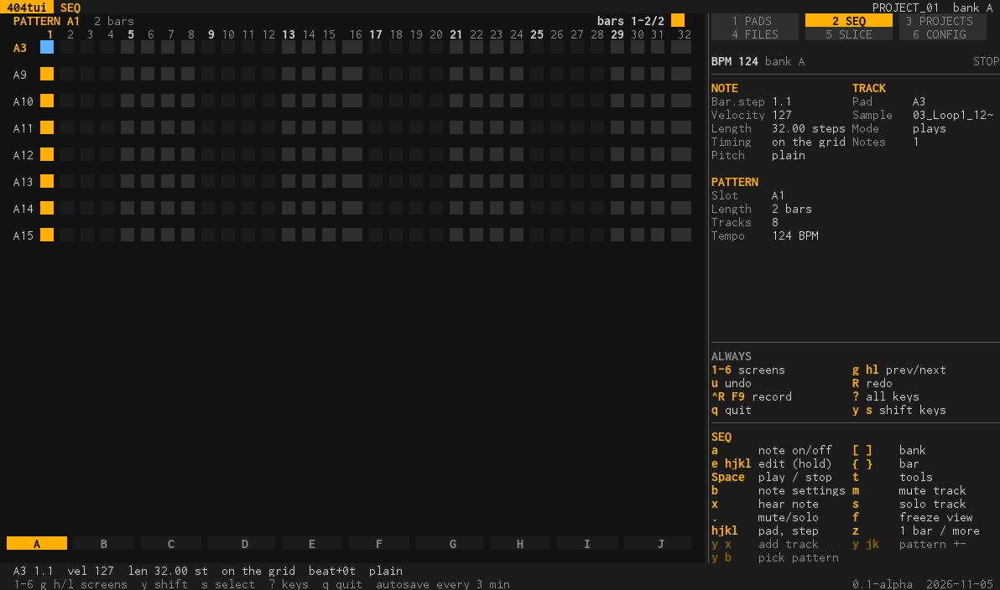
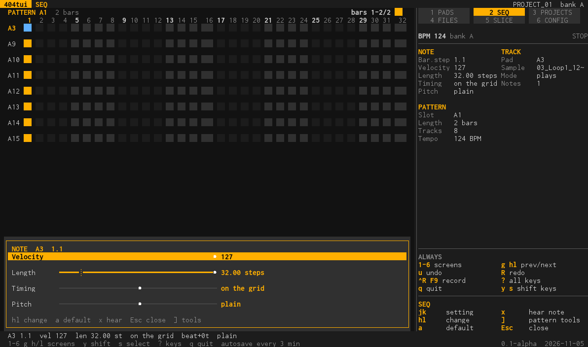
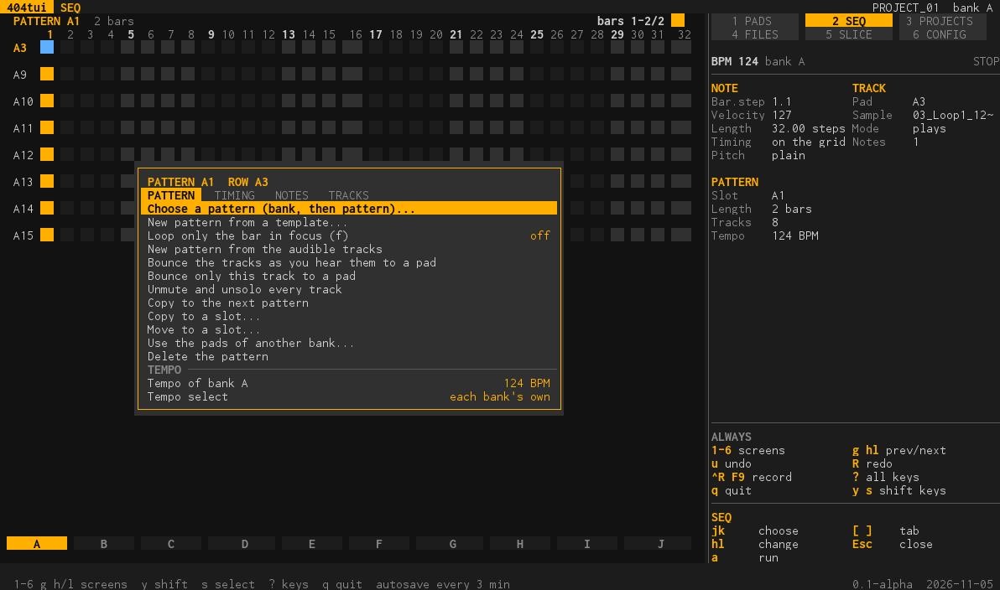
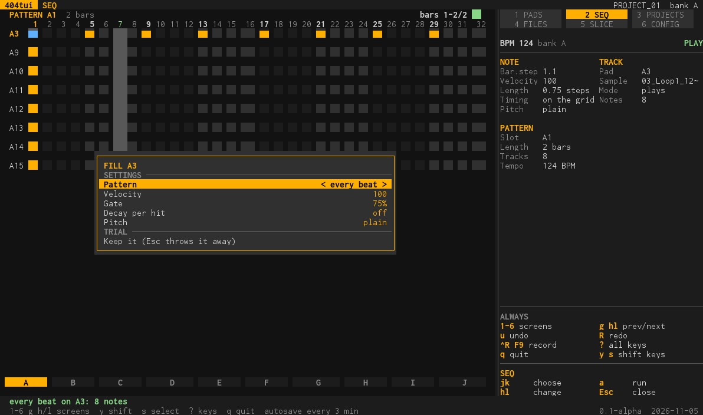
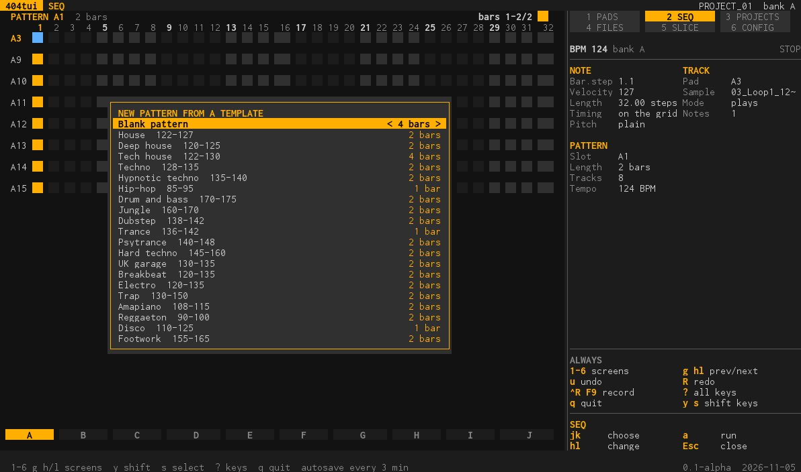
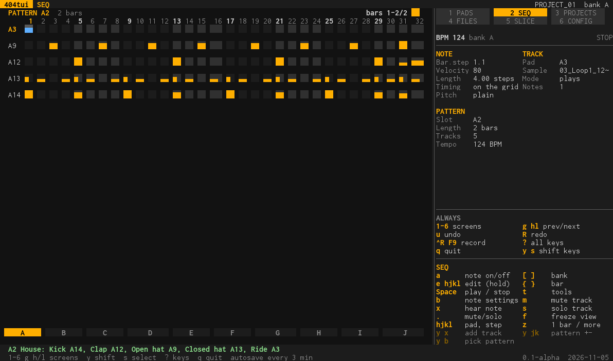
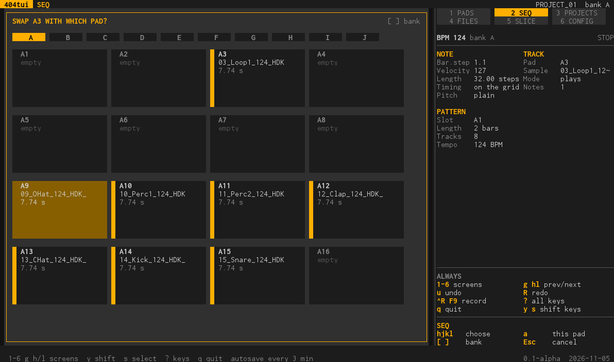

# SEQ (screen 2)

The pattern in front as the unit's step grid: a track for each pad that has notes, sixteenth-note steps, two bars side by side when the window is wide enough. The pattern is the unit's own format, so a pattern made here is a pattern of the project.

## What is on the screen

- **The grid:** each row is a pad (A3, A9, A10...), each box a step; a step with a note is lit, and the note is drawn as a bar as tall as its velocity. The steps are numbered through (1 to 32 for two bars). The cursor is one box.
- **The panel** tells about the note under the cursor (bar and step, velocity, length, timing, pitch), about the track (the pad, its sample, playing or muted or solo, the number of notes) and about the pattern (slot, length, tracks, tempo).
- `Space` plays the pattern in view and `Space` again stops it (`PLAY` / `STOP`). Changing bank or pattern while it plays leaves what plays alone.

## What you do here

- **Put and take notes.** `a` puts a note on an empty step (velocity 100) and takes it off again. `e` then `h j k l` edit while held: velocity, length, timing and pitch. `x` hears the note without starting the pattern.
- **The note panel** (`Enter` or `b`): velocity 1 to 127, length (from 15 ticks to the end of the pattern), timing (early or late, in ticks) and pitch (-12 to +12 semitones; plain when unchanged). `a` sets a value back to its default, `Esc` closes.

- **Move around.** `h j k l` pad and step, `[ ]` bank, `{ }` a bar on, `z` one bar or as many as fit, `f` freezes the view on the bar in focus so that it loops only that bar (`FROZEN`).
- **Pick a pattern.** `y b` opens the pattern dialog (bank, then pattern; `[ ]` for another bank), `y j k` steps through the patterns. A new one comes from a template or the audible tracks (below).
- **Tracks.** `y x` adds a track (choose a pad), `m` mutes the track, `s` solos it.
- **The tools** (`t`): the pattern's menu has pages for the *pattern* (choose, new from a template, copy and move, delete, bounce to a pad, tempo of the bank), *timing* (swing, humanize, quantize, shift, reverse), *length* (double, halve),
  *notes* (what writes and changes notes) and *tracks* (dispatch over the marked pads, copy to a pad, swap with a pad, clear, add a track).

- **Write notes with a tool.** The notes tools open a dialog with its settings, and the result is already in the pattern as a trial while the dialog is open: `Esc` throws it away, *Keep it* commits it as one undo step (`u` takes it back, `R` redoes).
  Fill (a rhythm, with velocity, gate, decay per hit and pitch), Euclid, Evolve over the bars, Echo, Ratchet, Accents and ghosts, LFO and ENV on the notes, Chance, Randomize velocity, Shape (gate, decay), Cycle, Nudge, Pitch (transpose, random, runs), Invert.

- **Start from a template.** *New pattern from a template...* lists rhythms from House to Footwork with their tempo and length; the one you pick becomes a new pattern in the next free slot, with named tracks.

| The templates | A template as a pattern |
| --- | --- |
|  |  |

- **Swap two tracks.** *Swap with a pad...* (page Tracks) asks for a pad with the same dialog that adds a track, and swaps the notes of the two tracks, with their mute and solo, as one undo step: the snare plays where the maracas were. In a frozen bar only that bar is swapped.

- **Tempo.** The tempo of the bank is set in the pattern tools (60 to 240 BPM); *Tempo select* chooses between each bank's own tempo and the project's.

## Keys

**On a computer:** `a` note on/off · `e h j k l` edit (hold) · `Space` play / stop · `Enter` or `b` note settings · `x` hear note · `h j k l` pad, step · `[ ]` bank · `p` the row of the bank's 16 patterns (arrows choose, the pattern changes as you move, `p` goes back) · `{ }` bar · `t` tools · `m` mute track · `s` solo track · `f` freeze view · `z` one bar / more ·
`y x` add track · `y b` pick pattern · `y j k` pattern +- · `u` undo, `R` redo.

**On the handheld:** `A` note on/off · `A` + D-pad edit (hold) · `X` play · `B` note settings · `L2` hear note · `R2` mute/solo · D-pad pad, step · `L1 R1` bar · `Y+X` add track · `Y+B` pick pattern · `Sel+B` tools · `Y+^v` pattern +-.

Every tool and setting with its values: [tools.md](tools.md#seq).
