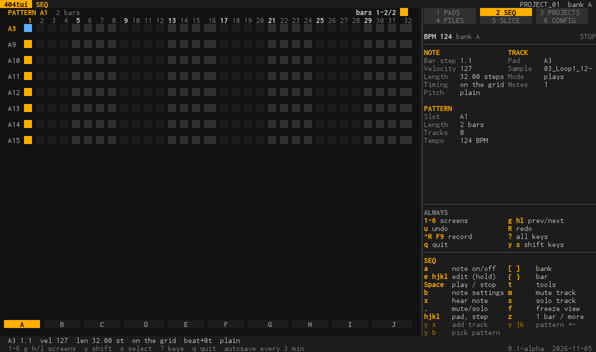
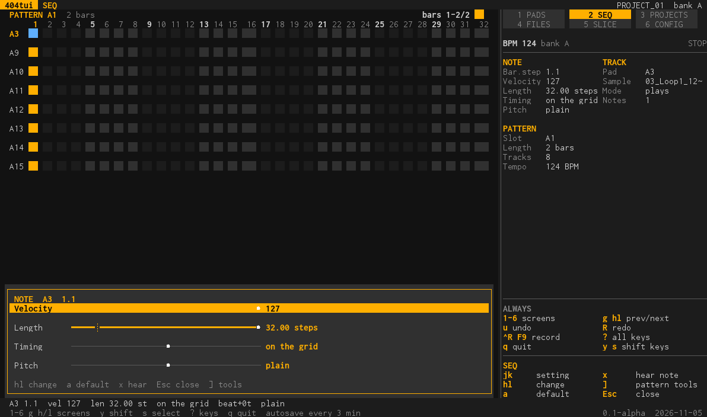
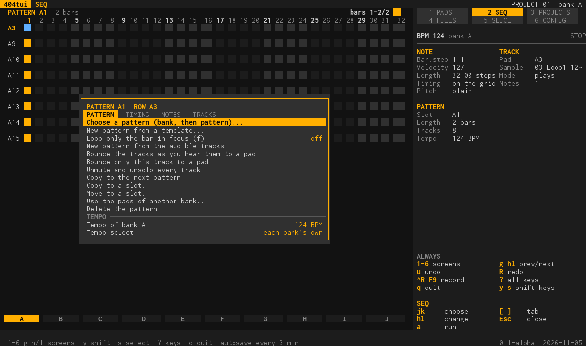
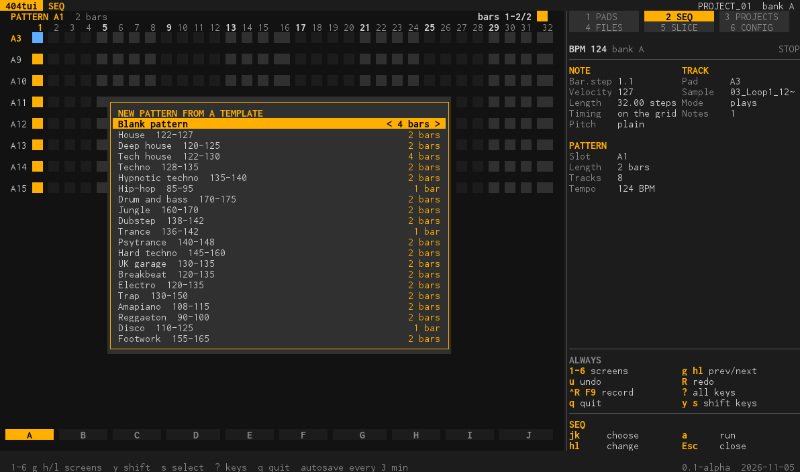

# SEQ (screen 2)

The pattern in front as the unit's step grid: a track for each pad that has notes, sixteenth-note steps, two bars side by side when the window is wide enough. The pattern is the unit's own format, so a pattern made here is a pattern of the project.

## What is on the screen

- **The grid:** each row is a pad (A3, A9, A10...), each box a step; a step with a note is lit, and the note is drawn as a bar as tall as its velocity. The steps are numbered through (1 to 32 for two bars). The cursor is one box.
- **The panel** tells about the note under the cursor (bar and step, velocity, length, timing, pitch), about the track (the pad, its sample, playing or muted or solo, the number of notes) and about the pattern (slot, length, tracks, tempo).
- `Space` plays the pattern in view and `Space` again stops it (`PLAY` / `STOP`). Changing bank or pattern while it plays leaves what plays alone.

## What you do here

- **Put and take notes.** `a` puts a note on an empty step (velocity 100) and takes it off again. `e` then `h j k l` edit while held: velocity, length, timing and pitch. `x` hears the note without starting the pattern.
- **The note panel** (`Enter` or `b`): velocity 1 to 127, length (from 15 ticks to the end of the pattern), timing (early or late, in ticks) and pitch (-12 to +12 semitones; plain when unchanged). `a` sets a value back to its default, `Esc` closes.

- **Move around.** `h j k l` pad and step, `[ ]` bank, `{ }` a bar on, `z` one bar or as many as fit, `f` freezes the view on the bar in focus so that it loops only that bar (`FROZEN`).
- **Pick a pattern.** `y b` opens the pattern dialog (bank, then pattern; `[ ]` for another bank), `y j k` steps through the patterns. A new one comes from a template or the audible tracks (below).
- **Tracks.** `.` adds a track (choose a pad; the dialog opens on the bank of the pattern), `d` removes the track under the cursor from the pattern, in the grid and in the mixer (every note of it; `u` brings them back), `m` mutes the track, `s` solos it.
- **Patterns.** `H` and `L` go to the pattern before and after, `K` and `J` a row of tiles up and down (4 patterns), without opening the tiles. `c` copies the pattern into the next empty slot and goes to the copy (`u` takes it back).
- **Play another pattern next.** While a pattern plays, going to another one (`H J K L`, the tiles, `y j k`, the dialog) only shows it, so going through the patterns is quick; the one that plays goes on. `n` has the pattern in view take over at the end of the round, without a break, as on the unit: the message line says which plays next, and the playhead comes over to it when it starts. `n` on the pattern that plays keeps it playing (nothing waits any more); an empty pattern leaves it alone; with nothing playing `n` starts the pattern in view. `Space` stops it all.
- **The tools** (`t`): the pattern's menu has pages for the *pattern* (choose, new from a template, copy and move, delete, bounce to a pad, tempo of the bank), *timing* (swing, humanize, quantize, shift, reverse), *length* (double, halve),
  *notes* (what writes and changes notes) and *tracks* (dispatch over the marked pads, copy to a pad, swap with a pad, clear, add a track).

- **A melody for a pad** (`t`, PATTERN, GENERATE, *Melody...*): notes at pitches for the track's pad (a sample, or the pad that plays a synth) in the key of the bank. The key is read from the bank's names (`G#`, `Gs`, `Am`, `Cmin`: the one most pads name; the message line says where it came from), else from the sound of its tonal pads; minor unless the names say major. Eight **types**, each with **settings of its own** shown under it (the ones of the other types are hidden, and each type keeps its own while another is chosen; settings that do not apply, as Echo or Ghost notes, are hidden too):
  **bass** (**Pattern**: the style's; offbeat 8ths, one note on every "and", the donk of 90s house and trance; rolling 8ths, every 8th on one note, a step down on beat 3; rolling 16ths around the kick; double offbeat, the "and" and the 16th after it; gallop, an 8th on the beat and two 16ths an octave up; octave, low and high in turn; sub, long roots; the root-fifth-octave roll, R...5R8RR...5R8R swung a little, Chris Stussy; stab and sustain; syncopated sustain; slide arc, two bars on the root, the third slides up to the fifth or fourth, the fourth slides home. **Approach**: the last note before a chord change a step from the next root, now and then, never or always),
  **303** (as the TB-303's sequencer: a row of pitches, each with its octave up or down, slide and accent, and a row of time, Note, Tie or Rest, each looping on its own; a pitch is taken at each Note, so when the rows differ the line turns over itself; the chords transpose it bar by bar. **Steps**: the time row 16, 15, 14, 12 (in line again every 3 bars, the acid techno trick), 8 or 7 long; **Pitches**: 1 to 3 (the type's), or 3 to 8; **Off-key notes**: the flat 2nd, flat 5th and major 7th now and then; **Slides**: the note held over the next, so a synth set to legato glides; **Octave jumps**: up, down or both; **Accent steps**: few, many or every step, accents in a row climbing as the 303's accent sweep; Density sets the rests and ties, busy has none),
  **lead** (**Phrase**: a motif, or call and response; **Leaps**: steps of the scale, or 4ths, 5ths and octaves),
  **arp** (**Direction**: every one of DOOM OS's arp and the sample ARP: up, down, up and down, up and down with the ends twice, down and up, random, order (root, fifth, octave, tenth), converge, diverge, pinky (the top between), thumb (the bottom between), thirds (1 3 2 4...), a scale run, the chord; **Span**: 1 to 3 octaves; **Gate**: 25 to 100%),
  **pluck** (**Hook**: 3 to 7 notes; **Placement**: the offbeats or anywhere),
  **stabs** (**Rhythm**: the style's, piano house (the chord broken, M1 style), a parallel shape (one chord shape moved as it is to other roots, even out of the key, as in Detroit techno and Kerri Chandler), a dub chord (a seventh chord on an offbeat and its echoes, each quieter, as a dub techno chord through a delay; with **Echo**)),
  **pad** (**Movement**: held, struck again each half bar, or rising from soft to loud four times a bar) and **drone** (**Drone note**: the root, with the fifth when busy, or the root and the fifth).
  The first one comes from the pad's name (bass, sub, acid or 303, pluck, piano, pad, dub or echo...).
  Settings: **Notes** (the style's own rhythm, or a note value: 1/2, 1/4, 1/8, 1/16, 1/32 and the 1/4, 1/8 and 1/16 triplets: the line is snapped onto that grid and its notes fill their value; finer than 1/16 adds quick doubles; an arp runs at that rate; held notes stay held), **Length** (the pattern's, or 1, 2, 4 or 8 bars: a shorter melody is repeated over the pattern; a longer one is played whole by the synth, looped at its own length, while the pattern keeps its first bars), **Style** (house, deep house, tech house, techno, trance, progressive, dub techno, acid house: the rhythm, the note lengths, and the chords when they are the style's), **Key**, **Scale** (minor, major, dorian, phrygian, harmonic minor, minor pentatonic),**Chords** (A or Enter opens the list of every progression with its chords and how it feels; the style's: each roll of the dice takes one of the style's loops:i VII (most often), i iv, iv VI i VII, i VI or VI VII i in house; i iv (most often), i VI iv, i iv VII, i VI or i VI III VII in deep house; mostly one chord in tech house (else i VI VII, i iv v) and techno (else the melodic techno loops i VII VI VII and i VI III VII over 2 and 4 bars a chord);i VI III VII (most often), i VII VI VII, i VII VI V, VI VII i, i VI VII or i v VI III, two bars a chord, in trance (as the 100 anthems of a trance study, and the loops TheoryTab has of trance artists); i VI III VII (most often), i III VII VI, i VI VII or i v VI III in progressive; one chord, i7 iv7 or i7 IVsus2 in dub techno; one chord in acid house; I IV or I V vi IV in a major key; one chord, the key's; or a progression of the chord tool: the bass follows the root of each bar's chord, the lead's strong steps are its tones, the arp, stabs and pads play it; give the bass, lead and pads the same key and progression and they fit together),**Chord length** (the style's, or 1, 2 or 4 bars a chord), **Chord notes** (the style's, triads, sevenths, ninths, sus2, dub: root, fifth, seventh and the third an octave up, or the seventh at the bottom as Kerri Chandler voices it; sevenths in house and tech house, ninths in deep house, sus2 in progressive; the seventh and ninth come from the scale, so the VII of a minor key is a dominant seventh; the stabs, pads, piano, dub chord and arp play them, NOW names them: Am9, G7, Fsus2), **Octave from** and **Octave to** (the type's own range, or -3 to +3: octave 0 goes from the pad's own pitch up, on the synth from C3, a bass's from C2; *from -3 to +2* spans six octaves; the wrong way round is turned round. A pad plays its sample an octave up and down at most, so on the pad the notes further out are moved into that range, an octave at a time; the synth plays them where they are),**Form** (A A' A B: the end of the bar changes in the second and fourth; A A B B: two bars, then two others; A A A A: the same bar; for the bass, lead, 303, stabs and pluck), **Swing** (the type's: the root-fifth-octave roll 57%, the rest straight; or none, 54%, 57%, 60%: every second 16th that much late, as on an MPC), **Echo** (a dub chord's: 3/16, the dotted 8th, or 5/16 or 7/16 between the echoes), **Density**, **Ghost notes** (quiet in-between notes, or some notes of a busy line made quiet) and **Accents** (the offbeats, the beats, here and there).The rhythms follow the styles: the house bass on the offbeat (an octave or fifth on the last one now and then) or the 3+3+2 cell, the broken offbeat in tech house now and then, the root on the beats and the fifth between them in techno, a held root under dub techno; the techno stabs on the "and" of 2 and 4, a push on the last 16th held over the bar, or every three 16ths against the kick (busy). The line is a motif, not notes at random: one bar, its strong steps on chord tones, then A A' A B over the bars, the last note coming home. The pitches are counted from the note the pad's sample is in (as the chord and arp tools guess it), so the notes are in the key. *Another roll of the dice* writes another one.
  **NOW**, at the foot of the dialog, shows the bars with their chord (G#m, E, B, F# for *Epic anthem* in G# minor) and the one that plays lit and the beat, what the time follows (the unit's clock or the pattern here), and which melody the synth plays: every change is a new one (#1, #2...), "from its next note" until its first note has gone out, then "on the synth since bar 3".
  The dialog does not start the pattern: `Space` plays it on the computer (and stops it), so the unit can be what plays.
  **For a sample**, offline or live: the melody is written on the pad's track and the pad's own sample plays it, pitched up and down (as the unit's chromatic keys do), on the computer with `Space`; *Keep it* puts it in the pattern, and a unit edited live gets the pattern as kept.
  **MIDI out** (only while the unit is edited live, and *off* at first: the sample plays) sends the trial to a synth instead of the pad: the notes go as MIDI notes on channel 11, 12, 13 or 14 to the unit's MIDI port (the one of CONFIG), and the unit passes them on through its MIDI out to the synth behind it (an MC-101 with a track on each channel: 11 bass, 12 synth/lead, 13 pads). Each type keeps its own settings while the program runs. The notes follow the unit's MIDI clock while it plays (the rounds counted from its Start, at its tempo), else the pattern on the computer; while the synth plays the line, the pad's sample is quiet on the computer. Every roll and change is heard on the synth at once, so the synth can record it. `sp404 doctor midi --channel 11-14` plays a few notes on those channels to the unit, to check that the synth behind it gets them. The tonic is played as C2-B2 for a bass, C3-B3 for the rest. Closing the dialog stops it (All Notes Off). The notes kept stay in the pattern on the pad.
- **Write notes with a tool.** The notes tools open a dialog with its settings, and the result is already in the pattern as a trial while the dialog is open: `Esc` throws it away, *Keep it* commits it as one undo step (`u` takes it back, `R` redoes).
  Fill (a rhythm, with velocity, gate, decay per hit and pitch), Euclid, Evolve over the bars, Echo, Ratchet, Accents and ghosts, LFO and ENV on the notes, Chance, Randomize velocity, Shape (gate, decay), Cycle, Nudge, Pitch (transpose, random, runs), Invert.

- **Start from a template.** *New pattern from a template...* lists rhythms from House to Footwork with their tempo and length; the one you pick becomes a new pattern in the next free slot, with named tracks.
- **Generate.** The GENERATE part of the PATTERN page holds what makes notes for you: *Generate a pattern (style, kit, variation)...* opens the same dialog on its GENERATOR page, *Melody...* writes a melody for the track's pad, and *Variation of this pattern* rolls a variation of the one in front (slightly different, a fill, a roll, thinner, busier, a break) into the next free pattern of its bank. After **Keep it** in the generator, *Variations of the kept pattern* goes straight there: keep one, roll the dice, keep the next, each in its own slot of the bank, all made of the kept pattern. *A played melody in a key: a new pattern...* takes a melody you played on a pad in chromatic mode, against any sample, and writes it again: you say the key you played it in (and the note of that sample), the key and scale to write it in, and the pad that is to play it (the bass, the synth). Every note moves by the same interval, the notes off the scale go to the nearest one in it (a tie goes down; or keep them as played), and the pitches are counted from the new pad's sample, so a G# stays a G# on a sample in C. It goes to the next empty pattern with the other tracks as they were; the played pattern stays. A pad goes an octave up and down at most: a note further out is moved an octave in. *Record this track from a synth (MC-101): arm, play, disarm...* records what you play on a synth into the track in front. The synth is on the computer's USB (its own MIDI port; **Port** is a part of its name, `mc-101` by default) and **Channel** is the one it sends on (12 at first). **Arm**, then Space plays the pattern (or start the unit: its MIDI clock is followed), and play: the notes are caught where they fall in the loop, every pass adding to the take (the same note on the same step again: the last pass wins); the starts snap to 1/16 (or 1/32, 1/8 triplets, or off). **Disarm** writes the pattern again to the next empty slot with the take on the pad, beside the notes the track had; the pattern played over stays. A note's pitch is counted from the pad's sample: **The pad's sample sounds at** says which octave of its note it is (C4, MIDI 60, at first), and a note further than an octave from it is moved an octave in. NOW shows whether it is armed, the notes and passes, where the loop is and the port. Esc throws the take away. On the MC-101 the track needs **Tx USB** and **Tx Note** on (SHIFT + TRACK SEL), and `sp404 doctor midi --listen` prints what comes in on the port, to check that it does.

| The templates | A template as a pattern |
| --- | --- |
|  |  |

- **Swap two tracks.** *Swap with a pad...* (page Tracks) asks for a pad with the same dialog that adds a track, and swaps the notes of the two tracks, with their mute and solo, as one undo step: the snare plays where the maracas were. In a frozen bar only that bar is swapped.

- **Tempo.** The tempo of the bank is set in the pattern tools (60 to 240 BPM); *Tempo select* chooses between each bank's own tempo and the project's.

A pattern can come from a MIDI file and go out as one: [midi.md](midi.md). In the pattern menu (`t`): *Export this pattern as a MIDI file*.

## Keys

**On a computer:** `a` note on/off · `e h j k l` edit (hold) · `Space` play / stop · `Enter` or `b` note settings · `x` hear note · `h j k l` pad, step · `H L` pattern -+ · `K J` 4 patterns -+ · `[ ]` bank · `p` the 4 by 4 tiles of the bank's patterns (arrows choose, the pattern changes as you move, `p` goes back) · `{ }` bar · `t` tools · `m` mute track · `M` the mixer · `s` solo track · `f` freeze view · `z` one bar / more ·
`.` add track (or `y x`) · `d` remove track · `y b` pick pattern · `y j k` pattern +- · `u` undo, `R` redo.

**On the handheld:** `A` note on/off · `A` + D-pad edit (hold) · `X` play · `B` note settings · `L2` hear note · `R2` mute/solo · D-pad pad, step · `L1 R1` bar · `Y+X` add track · `Y+B` pick pattern · `Sel+B` tools · `Y+^v` pattern +-.

Every tool and setting with its values: [tools.md](tools.md#seq).

## The mixer (`M`, on a computer)

`M` shows the pattern's tracks as a mixer in place of the grid: a strip for every pad the pattern plays, with its level (a fader),
its pan, its bus, mute and solo, and how many notes it has. `h l` choose the strip, `j k` set the level, `[ ]` the pan, `b` sends
the pad to BUS 1, BUS 2 or no bus, `m` and `s` mute and solo it (on the computer only, as in the grid), `x` hears the pad, `.` adds
a track, `d` removes the strip's track from the pattern (its notes; `u` brings them back), `H J K L` go to another pattern,
`Space` plays the pattern, `M` or `Esc` go back to the grid.

The level, pan and bus are the pad's own settings: the same as in the pad panel, kept in the project, undone with `u`, and sent to
the unit when it is edited live. While the pattern plays a change is heard at once. The unit has no EQ on a pad: an EQ is an effect
on a bus, so a pad is EQ'd by sending it to the bus that has the EQ.

