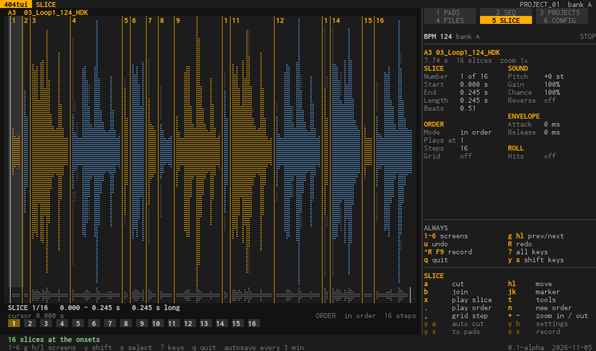
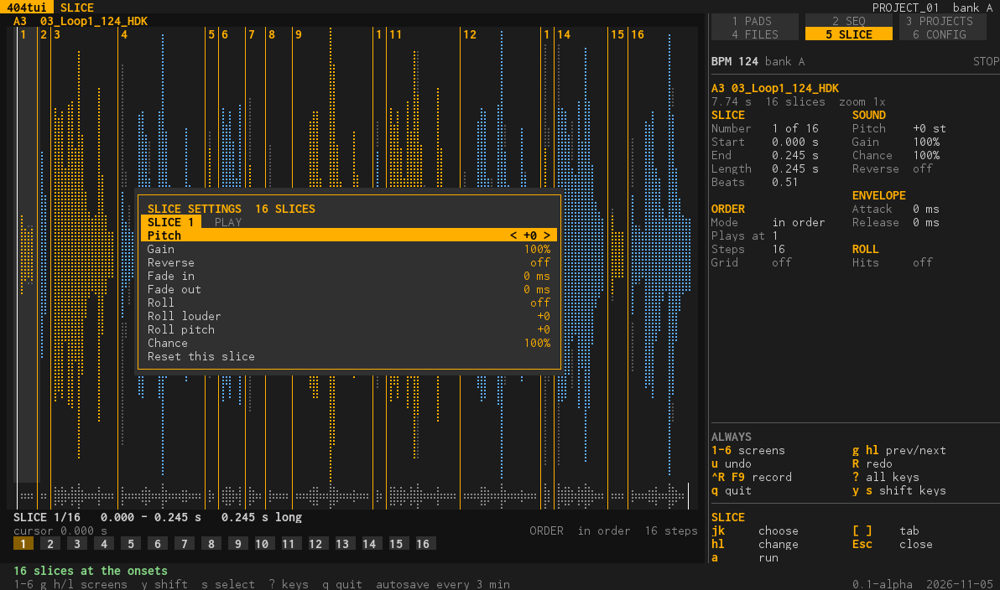
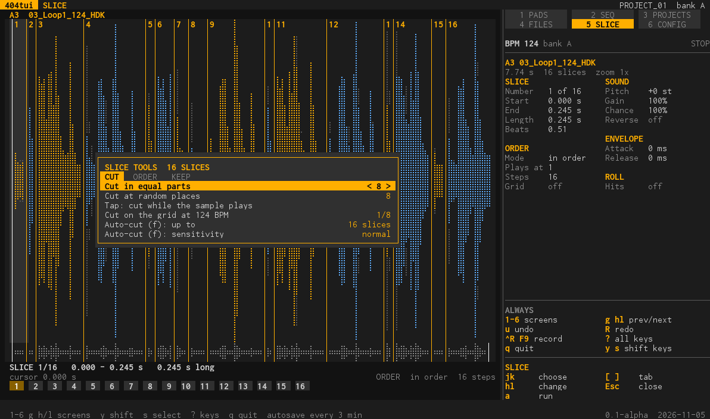

# SLICE (screen 5)

Cut a sample into slices and play them in an order. It opens on the sample of the pad under the cursor on PADS (a pad with no sample sends you back); `5` or the screen map goes there.

## What is on the screen

- **The waveform** of the sample with a marker at each cut, the slices numbered, the cursor on one slice, and under it the **order lane**: the order in which the slices play (1, 2, 3... or any other order).
- **The panel** tells about the slice under the cursor: its number, start, end, length, beats, pitch, gain, chance, reverse, envelope, roll, and where it plays in the order. The tempo and the zoom (`zoom 2x`) are in the panel too.

## What you do here

- **Cut.** `a` cuts at the cursor, `b` joins the slice with the next (removes the marker), `h l` move, `j k` move a marker. *Auto-cut* (`y a`) cuts at the onsets of the sound, up to a number of slices you choose (4 to 32) and with a sensitivity (low to high):
  on a drum break it finds the hits. The tools also cut in equal parts (2 to 32), at random places, on the grid of the bank's tempo (1/4 to 1/32), and *tap* (cut while the sample plays).
- **Zoom.** `+` and `-` zoom in and out on the waveform.
- **Play.** `x` plays the slice under the cursor, `.` plays the whole order in a loop (and again stops it), `n` makes a **new order** at once and plays it, and another `n` another one, while it plays; `x` stops. `,` steps the grid.
- **Settings of a slice** (`Enter`, or `y b`): pitch, gain, reverse, fade in and out, roll (2 to 8 hits, louder or quieter, with its own pitch) and chance. A second page, *Play*, sets the order mode (in order, random, no repeat, shuffle), the grid, swing, humanize and the length.

- **The tools** (`t`) have pages: *Cut* (above), *Order* (mangle the slices with dice, edit the order lane step by step, shuffle the order, back to 1, 2, 3...) and *Keep* (the result to a pad, the slices to pads, in order or at random, the slices to pads **and a pattern under them** with 1 to 8 bars, add the sample of another pad
  or a sample from a file, take the last added sample out).

- **Keep what you made.** `y x` sends the slices to pads: they land on consecutive pads from the one you choose, and the pad tiles show their lengths. With a pattern under them, SEQ then has the pattern that plays the slices.
- **Undo.** `u` takes back the last change (a removed slice, a cut in equal parts, a mangle...), `R` redoes it, and it goes on back.

## Keys

**On a computer:** `a` cut · `b` join · `x` play slice · `.` play order · `,` grid step · `h l` move · `j k` marker · `t` tools · `n` new order · `+ -` zoom · `Enter` settings · `y a` auto cut · `y x` to pads · `y b` settings · `u` undo, `R` redo.

**On the handheld:** `A` cut · `B` join · `X` play slice · `R2` play order · `L2` grid step · D-pad move and marker · `Y+A` auto cut · `Y+X` to pads · `Y+B` settings · `Sel+B` tools · `Y+^v` zoom.

Every setting and tool with its values: [tools.md](tools.md#slice). From a pad, `t` then *Slice...* opens the slicer on its sample ([pads.md](pads.md)).
