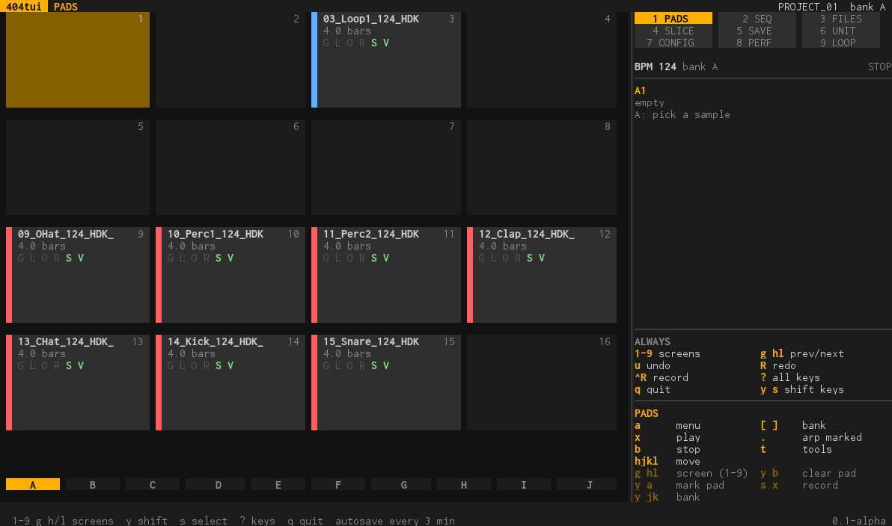
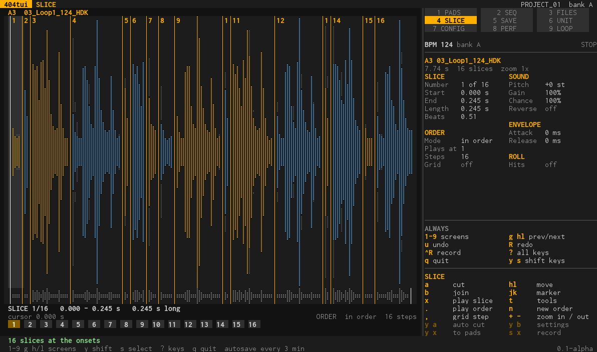
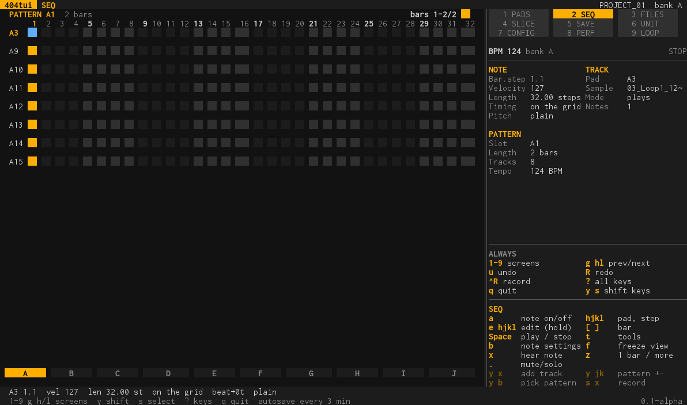

# The program: `sp404`

`sp404` with no command is the one program on Linux, macOS and Windows: the screens, the layout, the menus and the features of the
handheld version (R36S), drawn for a terminal window. The handheld version (`sp404h`) is the same program with its own drawing and
its own buttons. The earlier terminal program with its tabs is still there as `sp404 classic`.

    sp404                                  # starts in ~/404tui/samples, writes below ~/404tui/out
    sp404 -project "path/to/PROJECT_01"    # open a project folder (one with a PADCONF.BIN in it)
    sp404 -samples ~/Music/kits -out ~/Desktop/card
    sp404 -sim                             # PROJECTS finds a simulated unit
    sp404 -audio silent                    # nothing is played (for tests); the program acts as if it were
    sp404 classic                          # the earlier tabs

Flags: `-samples` (where the file browser starts), `-out` (where the card folder is made; settings, autosaves, backups and exports are kept
beside it), `-project`, `-basic-glyphs` (see below), and the usual `-sim`, `-port`, `-audio`, `-v`.

**Every screen, with its keys, menus and settings, is listed in [tools.md](tools.md)**, which the program's own test writes (so it is
always what the program has). What the keys are, how the layout works and what each screen is for is here.

## How the program is built

- **`core`** is the program: screens, menus, features, the project, the files, the unit, undo, recording. It knows nothing of a screen
  or a keyboard; it is told which buttons are pressed and it draws through a small drawing layer.
- **`platform/terminal`** is the computers' variant: a terminal window, the keyboard, the look of the earlier terminal program.
- **`platform/handheld`** is the R36S's: the framebuffer, the buttons, its pixel look. It has none of the terminal's code.
- A platform brings what only it has: audio output, a recorder, MIDI, the way to find the unit. What a system does not have is said so
  on screen ("no MIDI in this build", "this build cannot record") and the rest works.

## One layout on every size

The screen is a grid of characters, and every screen is laid out on it:

- The window is measured when the program starts and again whenever it changes.
- The right **30%** (at least 24 columns) is the panel that is always there: the screens with the one you are on lit, the tempo and
  whether the loop plays, what is under the cursor (pad, note, slice, file), and the keys: **ALWAYS** (the keys that work on every
  screen) and then the keys of the screen you are on.
- 80 columns by 30 rows is the smallest window (it is the handheld's screen). In a smaller one the program says so and waits.
- What is drawn in steps (the sequencer's steps, the banks, the pads) shares the whole width, whatever it is.
- The bottom right corner shows the version and the day the program was built (`sp404 -version` prints them too).

The look: flat tiles, one amber accent, rounded dialogs, waveforms in braille dots. 24-bit colour when the terminal has it, else the
256-colour palette. A terminal font with few glyphs (the old Windows console) gets only blocks: `-basic-glyphs` or
`SP404_GLYPHS=basic`. The colour theme (Hardware, Ocean, Paper) is set on CONFIG.

## The keys

### Always

| Key | What it does |
| --- | --- |
| `1`-`6`, `Tab`, `Shift-Tab` | go to a screen (the number is on the screen map in the panel) |
| `g h`, `g l`, `g g` | the screen before, the next, the first (as `gT`, `gt`, `gg` in vim) |
| `Esc` | close a menu, a panel or a dialog; in a dialog opened from a menu it goes back to that menu, and `Esc` again closes it. In a search it ends the search; in the screens it goes back |
| `u`, `R` (or `Ctrl-Y`) | undo, redo: the project's changes; in the slicer the changes of the slicing |
| `Ctrl-R` | record the unit's audio |
| `?` | the help page for the keyboard |
| `q`, `Ctrl-C` | quit (twice when the project is not saved) |
| `y`, `s` | Y or Select held for the **next** key: `y` then `a` is Y+A. These give the second functions the handheld has; most have a key of their own on a keyboard (see below). On SEQ `s` is solo, not Select |

### The D-pad and the buttons

| Key | Button |
| --- | --- |
| `h j k l` or the arrows | D-pad (as in vim) |
| `a` | A: do it, open, put a note, cut |
| `Enter` | the settings of what is under the cursor: the pad panel on a pad, the note panel on a note, the slice settings on a slice; `a` in a menu |
| `b`, `Backspace` | B: stop, join, back (not for closing menus: that is `Esc`) |
| `Space` | play and stop, everywhere: the pad's sample on PADS, what is listened to on FILES, the whole pattern on SEQ |
| `x` | stop what sounds on PADS and FILES; in SEQ it hears the note (Space plays the pattern); in the slicer it stops the sound |
| `m`, `s` | SEQ: mute or solo the track under the cursor (the same key again plays it) |
| `Ctrl-E` | PADS: export the bank (or the marked pads) as WAV files with `samples.json` into a folder you type |
| `t` | the tools of the screen (the TOOLS page of a pad, the pattern tools, the slice tools); on FILES where the files are loaded from (the computer, the samples, the unit's card, a drive, favourites) and a step on the file tools; on PROJECTS online or offline |
| `e` | holds A, for editing a note with the arrows in SEQ; `e` again lets go |
| `[` `]` , `PgUp` `PgDn`, `Ctrl-U` `Ctrl-D` | L1, R1: pages, banks, tabs, bars |
| `,` `.` | L2, R2 |
| `/` | search the files (a line at the bottom, typed into, filters at once; `Enter` keeps the result, `Esc` ends it) |

### Keys of one screen

| Screen | Keys |
| --- | --- |
| SEQ | `[` `]` the bank (the pattern at the same place in the bank before or after), `{` `}` the bar before and after, `z` one bar or as many bars as fit (two or four side by side on a wide window), `f` freeze: only the bars in view loop |
| SLICE | `+` zoom in, `-` zoom out, `n` a new order of the slices at once (a loop that plays goes on with it), `.` the order plays in a loop (again stops it), `Enter` settings, `t` tools |
| FILES | `/` search, `t` load files from where (and the file tools) |
| PROJECTS | `a` the project's menu, `t` online or offline and the offline folder |
| Names, folders, words | a prompt is one line you type into: `Enter` done, `Esc` gives it up (no keyboard of letters; the handheld keeps its on-screen one) |

The side panel always lists the keys that work now, in the keyboard's names; on the handheld it lists the buttons.

## The screens

Six screens side by side, numbered 1 to 6 on the screen map. Their menus and settings are in [tools.md](tools.md). (The handheld
also has SAVE, PERF and LOOP; on a computer the writing of the project is in CONFIG, and the unit's MIDI monitor and the looper are not part of this program.)

| Screen | What it is for |
| --- | --- |
| 1 PADS | the 4x4 pads of the bank (`m` marks a pad, `M` marks all and none, `r` renames it). A tile shows the name, the length of the loop in bars and the pad's switches (G gate, L loop, O one shot, R not forward, S BPM sync, V vinyl), and a strip in the colour of the pad's bus (blue BUS 1, red BUS 2). The panel tells everything about the pad: its sample, sound, envelope, routing and playback. `Enter` opens the pad panel: the settings, and the TOOLS (slice, chords and arps, arp from one sample, normalize, rename, copy, export the bank...) |
| 2 SEQ | the pattern as the unit's step grid, tracks as lines of step boxes, a note as a bar as tall as its velocity. `a` puts a note, `Enter` the note panel, `t` the pattern tools, `m` mute, `s` solo, `y` `x` adds a track. The panel: the note under the cursor (bar and step, velocity, length, timing, pitch), the pattern and the track |
| 3 PROJECTS | **online**: the unit's 16 projects as tiles (send, edit live, load, back up, save into a folder, restore, rename, make current, erase). **Offline**: the 16 projects of a folder on this computer (the card folder SAVE writes to, or one you choose): open one in the editor, write the project of the editor into a slot, export it into any folder. The project open last offline is remembered |
| 4 FILES | `m` marks the file and moves on; `M` marks every file of the folder; with files marked `a` puts them on the pads: files that start with a number (a kit: 03_Loop.wav, 12_Clap.wav) go on the pad of that number in the bank you choose, the others one after the other from the pad you choose, in the order of their names (clap_2 before clap_10); files named EMPTY and silent ones are left out. `a` on one sample opens the pad dialog (the same one as everywhere a pad is chosen) and puts it on the pad you pick. The ranger view on a wide window: the folder above, this one, and a preview of what the cursor is on (the contents of a folder, a sample's shape and length, its tags). Search, favourites, places, marks, copy, cut and paste between the computer and the card, **tags and the index of the unit's files** |
| 5 SLICE | cut by hand, tap, at the onsets, equal parts, random places, on the grid; the order lane; several samples; the pattern under the slices. The panel tells about the slice under the cursor: start, end, length, beats, pitch, gain, chance, reverse, envelope, roll, and where it plays in the order |
| 6 CONFIG | the **project** (its number, write it to the card folder, export it into a folder, the autosave, quit), the buses by pad name, the recorder, the pad codes of the unit, MIDI, the colour theme |

## Online and offline

The program looks for the SP-404MKII all the time (a USB cable, nothing to set up). The **start screen** says whether it found one:
`u` works online (PROJECTS shows the unit's projects), `o` works offline and opens the project that was open last offline; any other key
goes on with the project that is open. With no unit it says so and works offline. On PROJECTS, `t` switches between the two, and
chooses the folder of the offline projects. **While a unit is plugged in the panel has a level meter** (left and right, the highest peak
held for a moment, and a CLIP light), so the volume can be watched; it listens to the unit's USB audio with `ffmpeg` or `sox`. Under the bars, in a window of 36 rows or more, is a **spectrum** (64 bands from 30 Hz to 18 kHz, falling slowly).

`u` loads the unit's open project into the editor and edits it **live**: what you change goes to the unit, and what is changed on the unit itself (a pad sampled there, a setting turned) comes into the editor within a few seconds, for the 16 pads of the bank in view. Backups and exports (the unit's project menu, `Ctrl-E` on the pads, CONFIG) open a **folder chooser** (`l` opens a folder, `h` goes up, `Enter` uses the one in front, `x` makes a new folder, `/` types a path to go anywhere, the row `..` goes up, `[ ]` jump between home, the samples, the card folder and the drives); the folder is remembered. On FILES the left column of the top of a place lists the **sources** (computer, samples, drives, the unit's card and storage) with this one lit, and an index being built shows its progress in the panel.

## Tags and the index of the unit's files

With a unit plugged in, the files menu (`t` on FILES) can **index** the folder you are in: every sample gets tags worked out from its
name and the folders it is in (`SD:Synth/House/124_bass_wobble.wav` is synth, house, 124, bass, wobble). The index is one file on the
card, so any program that reads the card has it. **Search by tags** finds the samples that have them; **Tag** gives files (or the marked
files) tags of your own, **Favourite** the tag `favourite`. The tags of the file under the cursor are in the panel and in the preview. A
platform without a unit does not offer this; the computer's folders keep to the search of names.

## Recording a set

`Ctrl-R` records the unit's audio, from any screen, to a WAV in the folder CONFIG names, with `ffmpeg` (or `sox`): 24-bit, 48 kHz,
stereo, from the input with `404` in its name (the unit's USB audio). The red `REC` in the title bar shows the time. The panel's level meter shows the level of what is recorded. A system that cannot record says so instead of failing; the handheld has no recorder yet.

## The unit: whole projects, and live

- **Whole projects.** Load a project of the unit into the editor, change it, send it back; or back one up to the computer and restore it.
- **Live.** `a` on a project, *Edit live*: the project is loaded, the unit is switched to it, and from then on what is changed in
  the editor goes to the unit as it is changed: names, settings, samples, clears, patterns. Undo goes to the unit too. `LIVE n` in the
  title bar shows it, with how many changes are still on their way.

The unit is tried against its simulator (`sp404 -sim`); it has not been tried against a real SP-404MKII yet.

## Loading a project

Projects are folders with a `PADCONF.BIN`. **FILES**: go to the folder, the project is listed in green with the word *project*,
`a` loads it. **PROJECTS**: `a` on a project, *Open a copy in the editor* (online) or *Open it in the editor* (offline). From the command line: `sp404 -project <folder>`.

## What the program does not have

The features of the earlier tabs (`sp404 classic`) that were not moved here, on purpose: the Perform and Looper screens, the Faderfox EC4 map, the motion, punch, LFO and
morph of PERF, the web page for a phone, the columns view of the file browser, the conditions of the notes, the substep mode and the note
selection of the editor, and the checking and the origin of a pad's sample. Not tried on a real SP-404MKII, on real audio output, MIDI
or recording on macOS and Windows, and the handheld with these changes.

## Tests

- `go test ./core ./platform/...`: the keys, the layout at eight sizes, the unit against the simulator, MIDI, recording, the looper,
  undo on every screen, and a picture of every handheld screen that must not change when the terminal's look does.
- `go test ./core -run ToolsReference`: [tools.md](tools.md) is what the program says; the test fails when the file is out of date
  (`-update-docs` writes it).
- **End to end, on the computer's variant:** `platform/terminal/e2e/run.sh` starts the real program in a terminal (tmux) in an Ubuntu
  container against a copy of the Construction Kits House 01 project and its samples, and plays 13 use cases with the keys of
  this page. They are described in [e2e.md](e2e.md).
