# Perform on a phone: the web app

404tui can serve Perform to a browser on the same network, so a phone or tablet is a second screen with
big buttons: the pads, the clock, the cue, the motion slots, focus and the pad volumes. It is a
responsive page (portrait and landscape, from a small phone to a tablet) that opens from a link; nothing
is installed on the phone.

## Start it

```
sp404 serve
```

runs 404tui **without a screen** (a small computer in the stage case, or a laptop with the lid down), talks
to the unit and its MIDI, and serves the page. It prints where to go:

```
web page for Perform: open one of these on a phone on this network:
  http://192.168.1.20:8404/?key=k7p2mdq4
```

Under the link it draws a QR code of the first one: scan it with the phone camera instead of typing
(`sp404 serve` prints it under the link). The key is made once and kept (so the link stays the same from one run to the
next); the phone keeps it too. Ctrl-C stops the server and puts back what the program changed on the
unit (the buses of pads that focus made dry).

To try it without a unit: `sp404 -sim serve`.

| Flag | |
| --- | --- |
| `-web :8404` | the address to serve on (`serve` uses `:8404` by itself; `127.0.0.1:8404` serves this computer only) |
| `-web-key KEY` | the key a browser has to give; `none` lets everyone on the network in |

The browser can also be pointed at the computer by hand: open the page from anywhere (it asks for an
address and a key if it was not opened from the link), or give it in the link: `?host=192.168.1.20:8404&key=…`.

## On the phone

| PADS | PATTERNS | MOTION | TOOLS |
| --- | --- | --- | --- |
| 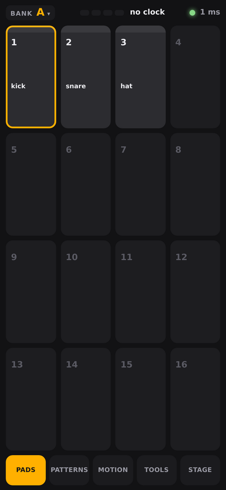 | 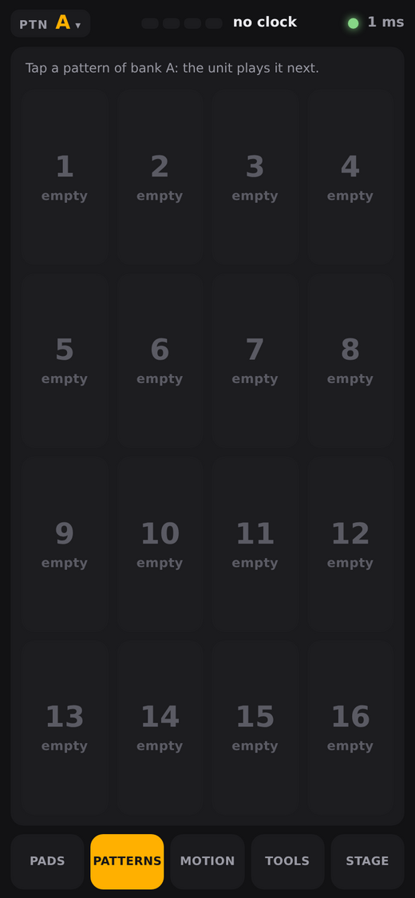 | 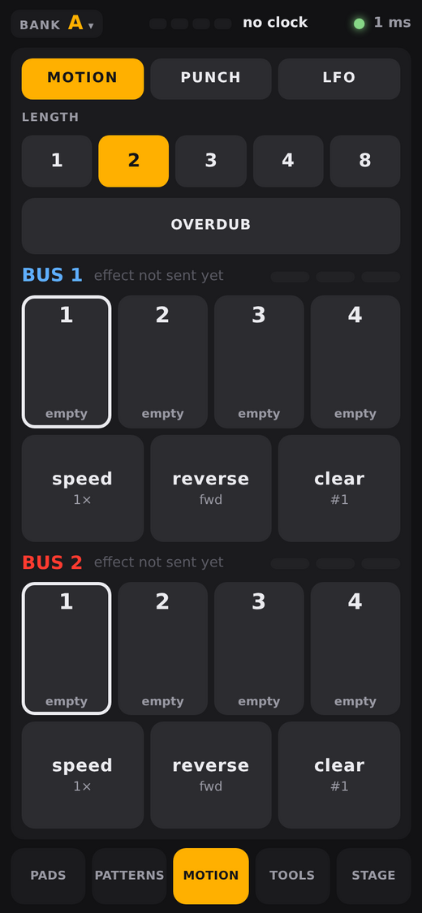 | 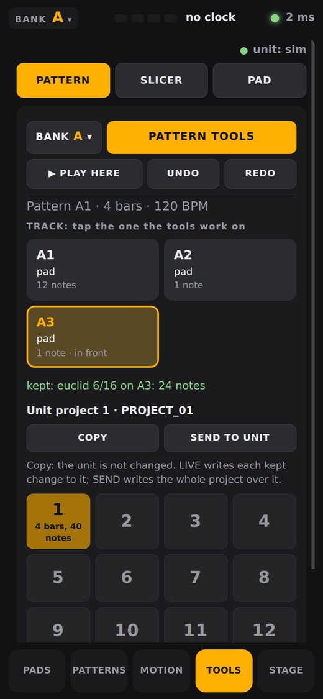 |

The tabs under the screen are PADS, PATTERNS, MOTION, TOOLS and STAGE (the bank, tempo, bar and beat, record, mix).

(Pictures taken against the simulator, so no clock and no level.)


*Landscape* (the way to play):

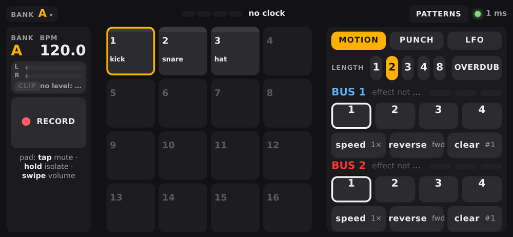

the pads in the middle, STAGE on the left (bank, tempo, bar and beat,
what plays now and next, record, focus, mix, next → now, clear next), MOTION on the right. On a small
phone the side panel is one of two tabs, STAGE or MOTION.

*Portrait*: the five tabs under the screen.

Everything reacts when the finger goes **down**, not when it comes up, and the page shows the round trip
to the program at the top right (a few milliseconds on a good network).

### Pads

| Tap | Does |
| --- | --- |
| a pad | mutes it (its volume goes to 0 on the unit; another tap brings back the level it had) |
| a pad, held (0.4 s) | it keeps its bus and the others on that bus go dry (the phone vibrates); hold more pads to keep them too; hold a kept pad again to let it go, the last one brings everything back |
| a pad while **FOCUS** is on | picks the pad: the picked ones keep their bus; FOCUS again puts everything back |

The tile shows the number, the name, the bus (a coloured box), the volume (the bar under the name),
the length in bars, and what the pattern does: **green** the pad was heard in the pattern that plays,
**tinted** it is in the pattern and not heard yet, an orange frame is the pad the unit has selected,
a red flash is a hit, **×** is muted.

**Swipe** up or down on a pad to change its volume from where it is (it is sent to the unit as you swipe). The level bar of a pad is at its top, and while you swipe a bubble above the pad shows the level (0 to 127), since the finger covers the pad.
A tap counts when the finger comes up, since until then it could still be a swipe. Zooming by double tap or pinch is switched off.

### The cue

Tap **NOW** or **NEXT** to choose the pattern of the bank that plays now or comes next (the unit does
not say which pattern runs, so it is told, as with `a` and `n` in the terminal). **NEXT ▸ NOW** makes the
next one the one that plays, **CLEAR NEXT** drops it.

### Motion

The same as MOTION in [perform.md](perform.md): the length in bars (1, 2, 3, 4, 8), four slots per bus
(tap an empty one to record from the next bar, a full one to play it, the playing one to stop it), and
**speed**, **reverse** and **clear** for the slot tapped last. **OVERDUB** adds the knobs you turn while a
slot plays. The slots draw the knob that moves most as a small curve, and a bar under it shows where the
loop is. Under BUS 1 and BUS 2 are the effect the unit reported and its three knobs.

Motion needs the unit's MIDI clock: start its sequencer.

### Punch

The side panel has three pages, **MOTION**, **PUNCH** and **LFO** (the choice is remembered). Punch is four snapshots of the
effects of **all four buses** (the effect, its six knobs, on or off). **Hold** one and every bus goes into that state; **let go** and each bus goes back to what it was just
before, wherever you had moved it since. Nothing waits for the clock: it is plain MIDI controllers.

The four chips at the top of the page show what the app knows of each bus: its effect and whether it is on (● on, ○ off).
**The unit only tells the app when something changes on it**, so an effect that was loaded and switched on before the app
listened shows as `fx ?` in red: a punch cannot put that back (it does not know what was there). Tap the chip and tell
the app (ON or OFF, and the effect from the list); nothing is sent to the unit. Or change the effect once on the unit.
Punch, Morph and the LFOs give back what the app knows.

To store: tap **SAVE** (it lights, and the four buttons say SAVE HERE), then tap a snapshot; it keeps what the
four buses are doing now. The dots show which buses a snapshot holds. They are kept between runs.

**EDIT** (the switch HOLD / EDIT / MORPH): hold a snapshot as usual, and turn the knobs (or change the effect) on the
unit while you hold it; when you let go the changes are kept in the snapshot, and the buses still go back to what they
were before. The page shows the snapshot's values as the unit does (effect, then each knob with its name and unit, like CUTOFF 60,
TIME 377 ms, FLT TYPE BPF): while you hold, what the buses are now, with whatever you changed lit; otherwise what is
stored. (The names and ranges are the unit's parameter lists; a knob that is tempo-synced shows its plain number.) A bus the snapshot did not hold joins it when you change something on it, but only shows up after you let go. In HOLD a tweak is only a
preview and is thrown away. Nothing is kept if nothing was changed (the message says so).

A snapshot (a preset too) always puts its effects on its buses. If the app does not know what a bus had before (the
unit says it only when it changes), the message names the bus: it cannot be put back exactly. On release the effect that the
snapshot switched on goes **off**, and the bus stays unknown (the chip stays red), because what the app sent is not what
the unit had. Tell the app with the chip (below), or change the effect once on the unit, and the punch gives it back. What
the unit says, and what you tell the app, is kept for the next run.

**MORPH** (the switch HOLD / EDIT / MORPH): in this mode a tap does not hold a snapshot but starts a morph to it. A
slider takes the place of the buttons: 0 is the state the buses were in when you tapped, 127 is the snapshot, and you
move between with a finger (or an encoder, below). Where the effect is the same the knobs move smoothly; an effect
that changes, a bus that goes on or off, and knobs that were not known at the start change halfway (at 64). Back at
0 everything is as it was. Tap the snapshot again, or STOP, to end it: the buses stay where they are. Tapping another
snapshot starts a new morph from the state the buses are in then.

On a **Faderfox EC4** a third group on channel 14 does the same: encoders 1 to 4 belong to snapshots 1 to 4. Turned
(CC 60 to 63, relative, 2 of 127 a click) it starts that snapshot's morph if it does not run and moves it; the push
(Note 60 to 63) starts or stops it. It works in either mode.

**PRESETS** opens a list of ready-made snapshots (RISER, TAPE, ECHO THROW, STUTTER, TAPE STOP, TELEPHONE). Pick the
snapshot they go into at the top (it starts at the first empty one and moves on after each tap), then tap a
preset. Each sets the effect, knobs and on for the buses it uses (the dots show which) and leaves the others
alone. The knob values are worked out from the unit's parameter lists but were chosen on paper, not by ear:
treat them as a start, hold one, and re-save your own version with SAVE.

Only what the unit has said over MIDI is saved: turn a knob of a bus once (or switch its effect) and it is
known. A bus with a motion playing is left alone. A value that was unknown when you pressed cannot be given
back and stays as the snapshot had it. If the finger is lost (the page hidden, the screen locked), the
snapshot lets go by itself; tapping the held one again does the same.

### LFO

Four LFOs that move a knob of a bus in time with the unit's MIDI clock. They send the controllers of the knobs, like
Punch, so they move the effects the unit has (no others). Pick an LFO (1 to 4), tap a setting to get a list of its choices and tap one, set the
**DEPTH** with the slider, and start it:

* **BUS** 1 to 4 and **KNOB** CTRL 1 to 6, or **ON/OFF**, the effect switch (a square makes a rhythmic gate).
* **SHAPE**: sine, triangle, saw up, saw down, square, random (a new value each cycle) and **pump**: a dip at the
  start of each cycle that comes back (the depth is how far it dips, down from where the knob was). Pump at **1/4**
  on a level knob of a bus effect, or on the LOW of an Isolator (bus 3 or 4), ducks what is on that bus on every beat:
  a pump by time, not a real sidechain, since it does not hear the kick. **SHIFT** moves it by a quarter of a
  cycle, to line the dip up with an off-beat kick.
* **RATE**: a cycle takes 1/16, 1/8, 1/4, 1/2 of a beat-note, or 1, 2, 4, 8 bars. The cycle begins with the bar of
  the clock, so an LFO is always in step with the pattern.
* It swings around where the knob was when you started it (a knob the unit has not said yet starts at the middle: turn
  it once on the unit first) and puts it back when you stop it, or when the clock stops (it goes on with the next
  start). A bus with a motion playing is left alone. A Punch that is held, or a Morph, takes the bus from
  an LFO on it: the LFO waits, and what the punch gives back is the knob where the LFO had it as its centre (and
  the effect switch as it was), then the LFO goes on.

Not tried on the unit yet: how the 7-bit steps sound on each knob, and how tight a pump feels against a kick.

## Tools: the pattern, slicer and pad tools

The **TOOLS** tab (in landscape the button at the top right goes Perform, Patterns, Tools) has the tools of the program in the page, with every page, setting and value that the terminal has ([tools.md](tools.md)). It works on **the project that is loaded on the unit**: there is no list of projects to choose from, and when the project is changed on the unit the page opens the new one within a few seconds.

Three modes under the top bar: **PATTERN**, **SLICER** and **PAD**.

| Pattern | The tools | A tool's trial | The bank |
| --- | --- | --- | --- |
|  | 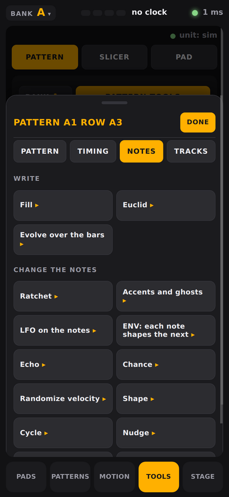 | 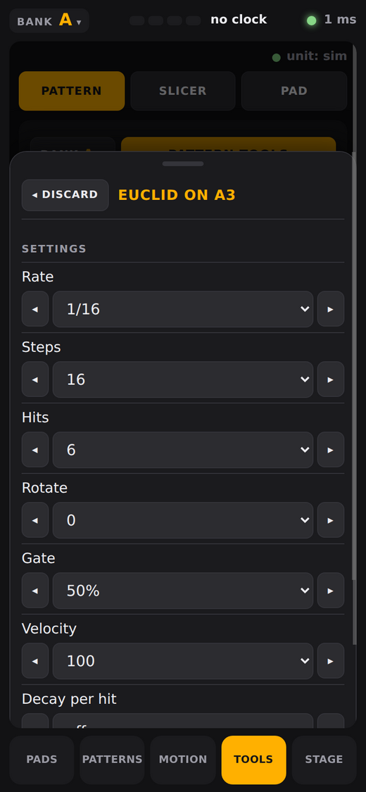 | 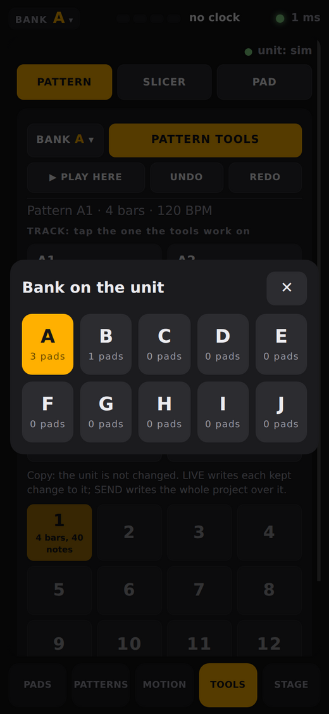 |

### Pattern

- **The toolbar** (it stays at the top while the page scrolls): **BANK** opens the page's own bank dialog (the bank is one for the whole page: Pads, Patterns and Tools always show the same one, and the unit moves to it), **PATTERN TOOLS** opens the tools, and **PLAY HERE**, **UNDO** and **REDO** are under them.
- **The tracks** of the pattern are tiles: the pad, its sample and how many notes it has (the pattern itself is on the unit). Tap one to put that track in front, outlined in the accent colour: the tools act on it.
- **MIDI FILE IN…** makes a pattern of a track of a MIDI file (it opens the form of the program: which part, which pad, which pattern); **MIDI FILE OUT** saves the pattern in front as a `.mid` file. → [midi.md](midi.md)
- **The 16 patterns** of the bank are a grid under the unit bar; a tap chooses the pattern. The ones with notes are outlined.
- **A menu is a sheet** that slides up over the page (the page dimmed behind it, a handle, the title, **DONE**; a tap on the dimmed page closes it). **PATTERN TOOLS** has the pages *Pattern*, *Timing*, *Length*, *Notes* and *Tracks* as the terminal's `t` has them; every tool is a tile, and a tap opens its options. A choice (a rhythm, a velocity, a gate...) lists **all** its values, with ◂ and ▸ to step.
- **A tool works on a trial.** Opening it applies it to the pattern at once, and a change of a setting applies it again; the line under the tracks says what it did ("kept: euclid 6/16 on A3: 24 notes"). **Keep it** commits the trial as one step **and goes back one menu**; **◂ DISCARD** throws it away. **UNDO** and **REDO** go through what was kept.
- **PLAY HERE** plays the pattern in a loop on **the speakers of the computer that runs `sp404 serve`**, not on the unit, so each trial can be heard while you change it.

### The unit: live, copy and send

The line under the tracks names the unit's project. It is edited **LIVE** by default: a tool that is kept is written to the unit, and then the unit is told to read the project again so that the pattern shows on it. **That stops the sound on the unit.** While the unit plays, the reload waits (the pattern is written, and the page says so); stop the unit, or press **RELOAD UNIT**, and it shows. The line under the pattern says "sending to the unit…" while a write is on its way, and why when it fails.

Press **LIVE** to switch to **COPY**: nothing is written to the unit, and **SEND TO UNIT** writes the editor's project over the unit's project when you want it (it asks twice, as it replaces the project). Changing the unit's project discards the changes of a copy. Back a project up before you edit it live (the terminal program: PROJECTS, then `a`).

### Slicer

| The slicer | Its tools | On a laptop |
| --- | --- | --- |
| 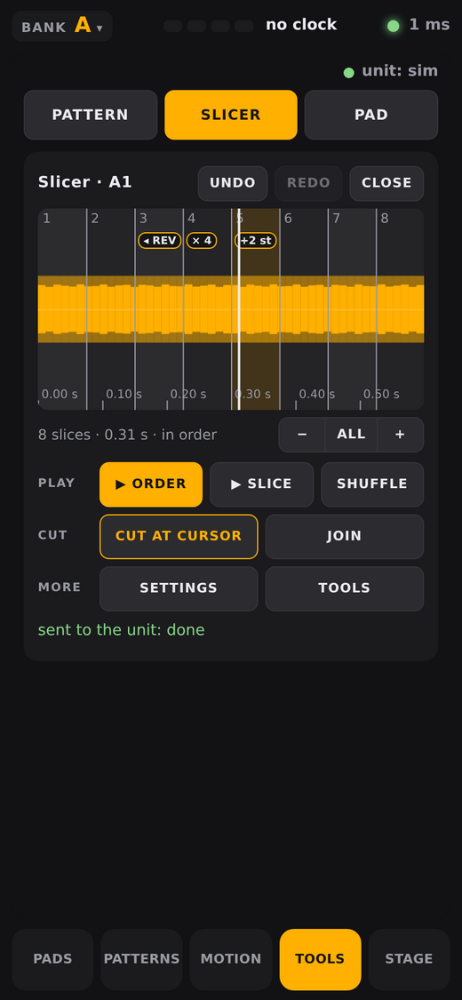 | 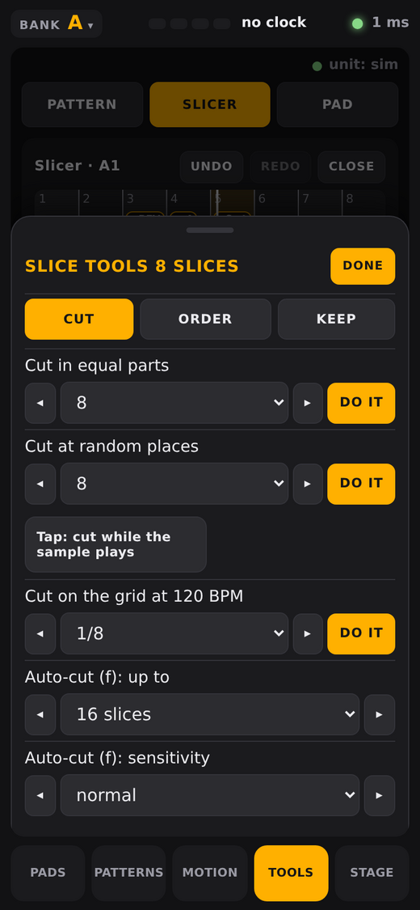 | 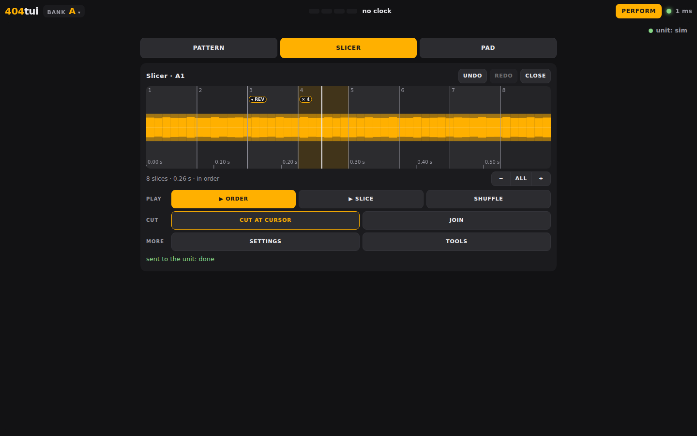 |

- Choose a pad with a sample (the bank is a button, the pads are a grid). The sample is a real waveform (lowest to highest sample of each column, the loudness inside it, a time scale) with the slices numbered and the one under the cursor lit. A slice that is reversed, rolls, is pitched or has a chance below 100 carries a small mark (◂ REV, × 4, +2 st, 50%).
- **Touch the waveform and slide**: the cursor follows the finger. **ZOOM −/ALL/+** by the info line change the window.
- **PLAY:** **▶ ORDER** plays the whole order in a loop (it turns into **■ STOP**; the slice that sounds is lit; any change of a setting, a cut, the order or an undo is heard in the loop at once), **▶ SLICE** plays the one under the cursor, **SHUFFLE** puts the slices in a new order. It plays on the computer's speakers.
- **CUT:** **CUT AT CURSOR** (moved to a zero crossing, as in the terminal) and **JOIN** (with the slice before).
- **MORE:** **SETTINGS** and **TOOLS** are the terminal's menus with all their pages: cut in equal parts, at random places, on the grid, mangle, play order, grid, swing, humanize, length, and the slices (or the result) to pads. A choice that is also done (*Cut in equal parts*: how many) has a **DO IT** button.
- **UNDO** and **REDO** go through the slicing. Switching to PATTERN or PAD and back keeps the slicing as it was (the cuts, the order, the settings); only **CLOSE** ends it.
- When a menu asks for a pad or a pattern (*Result to a pad*, *Slices to pads*) a dialog with the bank and its 16 cells opens; a name that is asked for opens as a text field. A dialog that only the terminal can show (the folder picker, the search keyboard, the slicer's tap and order lane) is named in a bar at the top with a button that closes it.

### Pad

Choose any pad: the menu of the pad's tools opens (pick a sample, slice, chords and arps, keyboard, rename, reverse, normalize, pitch, pattern with this pad, move, swap, copy, and the tools of the bank).

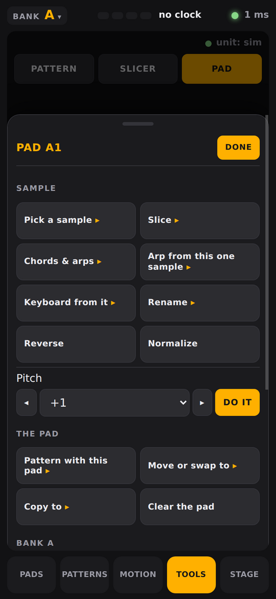

### On a laptop

The page keeps a readable width in the middle of the window.

| Pattern | The tools |
| --- | --- |
| 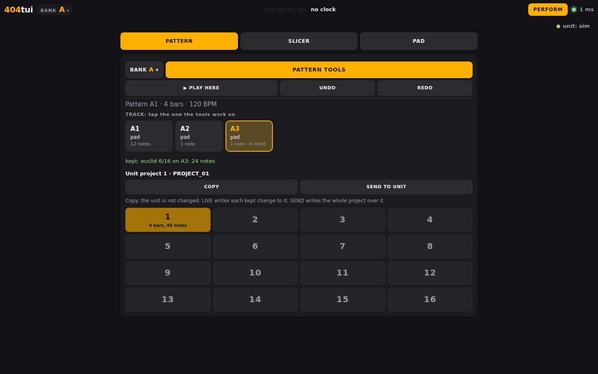 | 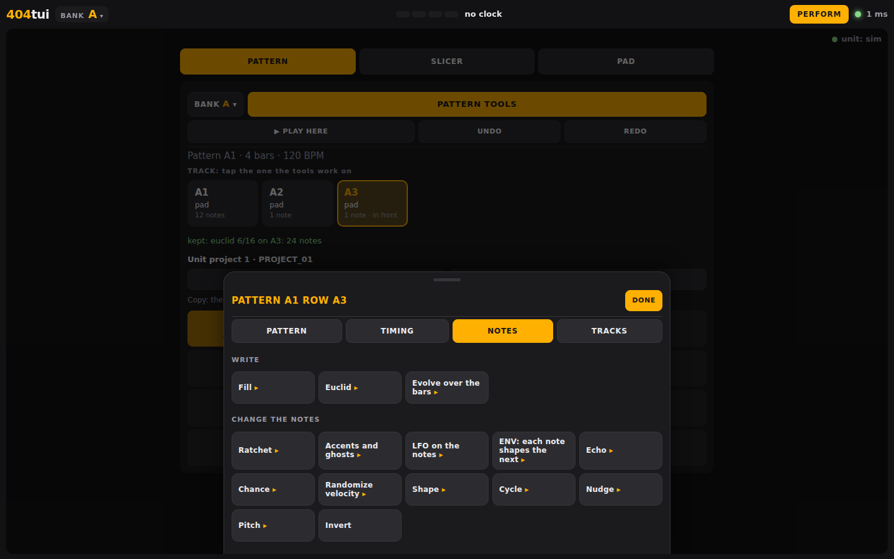 |

### Notes

The page runs in the same process as the rest of `sp404 serve` and uses its connection to the unit (only one program can hold the unit's serial port). It does not listen to MIDI itself, so the controller groups ([ec4.md](ec4.md)) are not in it. It is behind the same key as the rest of the page. The Looper tab of earlier versions, with its Slicer, is gone: the slicer is here.

## What it needs

* The computer runs 404tui (`sp404 serve`), with the unit plugged in by USB.
  MIDI (the clock, the pads you hit, the knobs) needs a build with MIDI: the release builds have it, and
  `make build` makes one; without it, the page shows the pads and takes the pad and volume commands.
* The phone and the computer are on the **same network**. A guest network that keeps devices apart
  (client isolation) will not do, and a firewall has to let port 8404 through (macOS and Windows ask the
  first time).
* The page keeps the screen of the phone on while it is open, when the browser allows it. "Add to home
  screen" opens it without the browser's bars.

## Safety

The connection is plain HTTP and WebSocket on your own network, protected by the key in the link: whoever
has the link can play the pads. It is meant for a stage or a studio network, not the internet; do not
forward the port. `-web 127.0.0.1:8404` keeps it on the computer, `-web-key none` turns the key off.

## For developers

The program sends its state as JSON over the WebSocket at `/ws` each time it changes (at most what the
network carries: a slow phone skips states), and takes commands as JSON: `{"a":"pad","i":3}`, `mute`,
`solo`, `level` (`i`, `v` 0–127), `focus`, `rec`, `motion` (`bus`, `slot`), `mclear`, `mspeed`, `mrev`
(`bus`), `bars` (`n`), `dub`, `cue` (`i`, `n` 1 now, 2 next), `nextnow`, `clearnext`. The code is in
`web/` (server and page) and `tui/web.go` (state and commands).

## Level meter

A stereo level meter (left and right, with the held peak as a white mark and a **CLIP** light that stays on for
five seconds after the sound reached full scale) sits on the stage panel. It is
there to see whether the sound is loud enough: it shows what the unit sends over USB all the time a browser is
open (on Linux the program listens itself, elsewhere ffmpeg or sox does), and the sound being recorded (marked **REC**) while Ctrl-R runs. The number is the loudest recent peak in dB below full scale: aim for the yellow, not the red.
If the computer cannot listen, the meter says why.

The bank chip at the top left of the page opens a list of the ten banks with the number of pads that hold a sample; choosing one moves the unit to that bank, as the bank keys do in the Pads view. **The bank is one for the whole page**: the Pads, the Patterns and the Tools show the same one.

## Patterns

The **PATTERNS** tab in portrait (the button at the top right in landscape goes Perform, Patterns, Tools) shows the 16 patterns of a bank, each with the number of pads it plays; empty slots are dark. The pattern that plays is **lit**. The program finds it from the pads the unit plays (the unit sends every note of a pattern over MIDI, and the patterns whose pads fit what is heard are looked for in all ten banks), and the page follows it to its bank when it changes; the chip at the top left (PTN there) chooses another bank, which stays until the pattern that plays changes.

Tapping a pattern makes the unit play it **next**: the program sends a MIDI Program Change on the channel of the bank (1 for A to 10 for J) with the number of the pattern, as 404jam does. The unit needs **PC Rx** switched on (and the MIDI mode B of its MIDI settings). The pattern sent **blinks until it is really playing**: it becomes the lit one when the pads heard in the last bar fit its notes clearly better than the notes of the pattern that played (so the old pattern keeps the light until the unit has switched, whenever that is). Two patterns that no pad tells apart (or one that has too few notes to hear) take over after a whole pattern has gone by after the time the old one was due to end. The unit does not confirm anything, so all of this is the program's reading of what the unit plays.

A **double tap** on the Patterns button (the tab in portrait, the button at the top right in landscape) shows the bank of the pattern that plays, whatever bank was chosen on the page.


## Without a server: the page on GitHub Pages

The same page also runs on its own at <https://moahbeatlab.github.io/404tui/> (built by `make site`, deployed by `.github/workflows/pages.yml`).
There is no program behind it: `web/static/engine.js` does in the browser what `sp404 serve` does for Perform, and talks to the unit by **Web MIDI**.
It needs Chrome or Edge on a computer, or the MIDIWeb Browser app on an iPhone or iPad (the other iOS browsers have no Web MIDI). **Connect the
SP-404MKII** picks the unit's MIDI port (as 404jam does), **Try the demo** runs the same page against a made-up unit with a clock at 125 BPM.

What works there, as in the program: the clock (BPM, bar and beat), the pads (a tap plays the pad on the channel of the bank), **Motion**, **Punch**
with its presets, **Morph** (slider, and the EC4 group on channel 14), the four **LFOs**, and the **Patterns** page (a Program Change). The effects
and the knobs a bus has are what the unit says over MIDI, and what was punched is kept in the browser. What needs the unit's USB serial link is
not there: the pad names, levels and samples, recording, the level meter and the Tools.

`engine.js` is a port of `tui/motion.go`, `punch.go`, `morph.go`, `lfo.go` and of what `midi.go` does with a message: change one, change the other.
`fxdata.js` (the effects, their knobs and the presets) is made from `tui/fxnames.go`, `fxparams.go` and `punchpresets.go`; a test fails when they differ.
